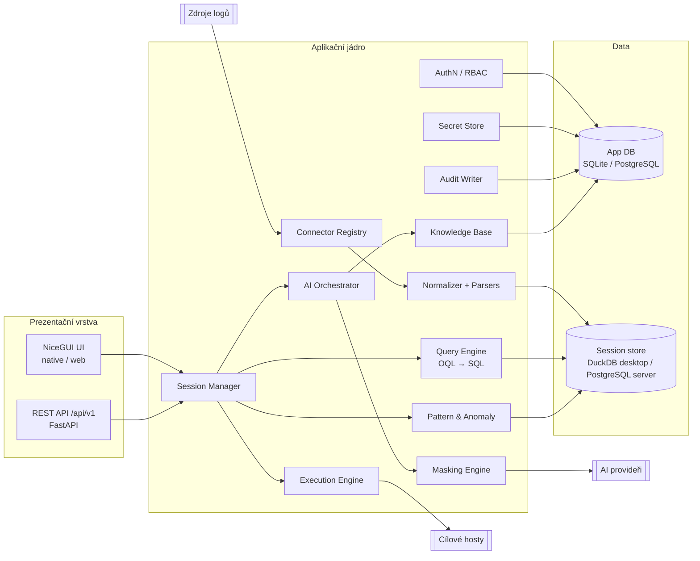

# OpsAI — Technické zadání (TZ)

| Položka | Hodnota |
|---|---|
| Dokument | Technické zadání (TZ) |
| Produkt | OpsAI |
| Verze | 0.2 (návrh k review) |
| Varianta | B — Meta (Meta Model API) |
| Datum | 2026-10-27 |
| Autor | Ivar Beliš |
| Vstup | OpsAI_BZ_v0.3.md (varianta B) |
| Související varianty | A (OpenAI/Claude/Gemini): https://github.com/RaviSileb/OpsAI-A · C (M365 Copilot): https://github.com/RaviSileb/OpsAI-C |
| Stav | DRAFT |

### Historie změn
| Verze | Datum | Změna |
|---|---|---|
| 0.1 | 2026-10-27 | První návrh |
| 0.2 | 2026-10-27 | Rozdělení na varianty A/B/C. Odeslání na rozhodnutí uživatele + restricted mode. Spuštění = schválení, běh celého postupu. Audit plného textu payloadu, bez auditu čtení. Whitelist + blacklist modelů, allowlist, normalizace tokenů, FR-412–415, zákaz řetězení (FR-544), PostgreSQL session store pro server, ECharts, nové UI akce (FR-764–769), DPIA (NFR-141). |

### Konvence
- Požadavky: FR-nnn (funkční), NFR-nnn (nefunkční), CON-nnn (constraint, převzaté z BZ a technické). Priorita MoSCoW: M/S/C/W.
- Sloupec „BR“ odkazuje na business požadavek z BZ. Úplná matice je v kap. 17.
- Míra jistoty u údajů o externích API: **[ověřeno]** = z oficiální dokumentace k 2026-10-27, **[ověřit]** = nutno potvrdit při implementaci.
- Neznámé údaje: [TBD-nnn: co chybí | kdo doplní]. TBD-001 až TBD-015 jsou převzaty z BZ (TBD-012 zrušeno), nové TBD začínají od TBD-101.

---

## 1. Rozsah a vazba na BZ

TZ pokrývá MVP dle BZ kap. 3.1. Fáze 2 (BZ 3.2) je zohledněna pouze rozšiřitelností rozhraní (kap. 4.1). Mimo rozsah (BZ 3.3): RabbitMQ, lokální LLM, automatické spouštění bez schválení, mobilní klient.

---

## 2. Architektura

### 2.1 Komponenty



| Komponenta | Odpovědnost |
|---|---|
| Session Manager | Životní cyklus relace: vytvoření, načítání zdrojů, stav jobů, uzavření a archivace |
| Connector Registry | Pluginové konektory zdrojů (kap. 4) s jednotným rozhraním |
| Normalizer | Převod na jednotný záznam (kap. 3.2), parsování času, úrovně, víceřádkové seskupení, určení hostu původu |
| Query Engine | Parser dotazovacího jazyka OQL (kap. 6.4), převod na parametrizované SQL nad DuckDB |
| Pattern & Anomaly | Drain3 šablony, trendy, detekce anomálií, porovnání oken |
| Masking Engine | Detekce a pseudonymizace citlivých dat, mapa záměn, ověření po maskování |
| AI Orchestrator | Redukce dat, sestavení promptu, volání providera, validace odpovědi, depseudonymizace |
| Execution Engine | Inventář hostů, exekutory, stavový automat běhu, politiky |
| Knowledge Base | Ukládání analýz, vyhledávání podobných případů |
| Audit Writer | Append-only audit s hash řetězcem, export |
| Secret Store | Abstrakce úložiště credentials (keyring / šifrovaný trezor / Vault / Key Vault) |
| AuthN / RBAC | Lokální účty, OIDC, LDAP, role, oprávnění na objekty |

### 2.2 Režimy běhu

| Režim | Popis | DB | Autentizace | Exekutory |
|---|---|---|---|---|
| Desktop (single-user) | NiceGUI `native=True` (pywebview okno), lokální proces | SQLite (`%APPDATA%\OpsAI` / `~/.local/share/opsai`) | Žádné přihlášení, volitelný zámek master heslem | SSH, PSRP, kubectl, lokální shell (výchozí vypnuto) |
| Desktop klient serveru | Desktop UI napojené na serverovou instanci přes REST API | serverová | OIDC device flow nebo PAT | serverové |
| Server (multi-user) | NiceGUI + FastAPI v Docker kontejneru, přístup přes prohlížeč | PostgreSQL ≥ 15 (app + session store) | lokální, OIDC, LDAP | SSH, PSRP, kubectl, az (varianta image `full`) |

- Serverová instance je **jedna replika** (stav relací v DuckDB souborech na volume). Horizontální škálování není v MVP požadováno.
- Desktop i server sdílejí stejný kód. Režim volí konfigurace `OPSAI_MODE=desktop|server`.

### 2.3 Technologický stack

| Oblast | Volba | Poznámka |
|---|---|---|
| Jazyk | Python 3.12+ | CON-002 |
| UI | NiceGUI (aktuální stabilní major, zafixovat v lockfile) | CON-002. Native režim přes pywebview: Windows vyžaduje WebView2 Runtime, Linux GTK WebKit2 nebo Qt. Grafy (histogram, časová osa) přes ui.echart (Apache ECharts). |
| Web/API | FastAPI (NiceGUI na něm běží), Uvicorn | OpenAPI 3.1 generováno automaticky |
| Validace | Pydantic v2 | |
| App DB | SQLAlchemy 2.x + Alembic; SQLite (desktop), PostgreSQL (server) | |
| Session store | Desktop: DuckDB (1 soubor na relaci) + PyArrow; server: PostgreSQL (kap. 6.1) | Sloupcové/řádkové úložiště, regex a agregace nad 1 GB, spill na disk |
| Parsery | lark (OQL), python-dateutil, charset-normalizer, python-evtx, orjson | |
| Šablony logů | Drain3 | |
| Maskování | Microsoft Presidio (analyzer + anonymizer) + vlastní recognizery | Jména osob v češtině viz M-12, TR-04 |
| Kafka | confluent-kafka (librdkafka) | SASL PLAIN/SCRAM/OAUTHBEARER/GSSAPI, mTLS |
| SSH/SFTP | asyncssh | jump hosty, certifikáty, agent |
| Windows Event Log | pywin32 (lokálně, jen Windows), pypsrp (vzdáleně, všechny platformy), python-evtx (soubory) | |
| Kubernetes | kubernetes (oficiální klient) + bundled `kubelogin` pro AKS/Entra ID | |
| Docker | docker SDK pro Python | Podman přes Docker-kompatibilní API |
| Loki | httpx + websockets | |
| Elasticsearch/OpenSearch | elasticsearch-py / opensearch-py | |
| Azure Monitor | azure-monitor-query + azure-identity | |
| AI SDK | openai (OpenAI-kompatibilní klient), httpx | Meta Model API přes OpenAI-kompatibilní endpoint |
| Credentials | keyring, cryptography (AES-256-GCM), hvac, azure-keyvault-secrets | |
| AuthN | authlib (OIDC), ldap3, argon2-cffi | |
| Export | Jinja2, markdown-it-py, WeasyPrint | PDF na Windows viz TBD-103 |
| Balení | `nicegui-pack` (PyInstaller) pro Windows (.exe + instalátor) a Linux (AppImage, .deb); Docker multi-arch (amd64, arm64) | |
| Kvalita | ruff, mypy (strict pro core), pytest, testcontainers, Playwright (E2E) | |

### 2.4 Struktura repozitáře (doporučená)

```
opsai/
  app/            # bootstrap, konfigurace, režimy
  ui/             # NiceGUI stránky a komponenty
  api/            # FastAPI routery /api/v1
  core/
    session/  normalize/  query/  patterns/  masking/  ai/  execution/  kb/  audit/
  connectors/     # file, ssh, kafka, wineventlog, syslog, journald, docker, k8s, loki, elastic, azuremonitor
  providers/      # meta
  secrets/        # keyring, vault_local, hashicorp, azure_kv
  auth/
  db/             # modely, migrace (alembic)
  i18n/           # cs.json, en.json
  prompts/        # verzované šablony promptů (YAML/Jinja2)
tests/  docker/  packaging/  docs/
```

---

## 3. Datový model

### 3.1 Aplikační DB (entity)

| Entita | Klíčové atributy |
|---|---|
| User | id, username, display_name, auth_source (local/oidc/ldap), password_hash (argon2id), locale, enabled, last_login |
| Role | id, name (viewer, analyst, operator, approver, admin), permissions[] |
| Group | id, name, external_id (OIDC claim / LDAP DN), role_ids[] |
| Credential | id, name, type (viz 5.1), owner_id, scope (personal/role/global), secret_ref, metadata (bez tajemství), expires_at, created/updated |
| ConnectionProfile | id, name, connector_type, config (JSON, bez tajemství), credential_ids[], owner_id, scope, rate_limits, enabled |
| HostInventory | id, hostname, aliases[], fqdn, ip_addresses[], environment (dev/test/prod/other), os (linux/windows), executor_type, connection_profile_id, run_as, tags[] |
| Session | id, name, owner_id, created_at, status, duckdb_path, size_bytes, record_count, tz_display |
| SessionSource | session_id, connection_profile_id, query_params (JSON), job_status, records_loaded, error |
| SavedQuery | id, name, oql, owner_id, scope, created_at |
| Annotation | id, session_id/kb_id, record_ref, ts, text, author_id, scope |
| Analysis | id, session_id, provider, model, payload_mode, payload_sha256, token_in/out, cost_estimate, status, prompt_version, created_by |
| AnalysisMessage | id, analysis_id, role (user/assistant), content_masked, created_at |
| RemediationPlan | id, analysis_id, steps (JSON dle 9.5), status |
| ExecutionRun | id, plan_id, requested_by, status, started/finished, dry_run |
| ExecutionStep | id, run_id, order, target_host_id, shell, command_final, command_original, risk, approvals[], status, exit_code, stdout_ref, stderr_ref, duration_ms |
| KBEntry | id, title, problem, root_cause, resolution, commands, outcome, rating, source_types[], template_hashes[], tags[], analysis_id, created_by |
| ProviderConfig | id, provider, enabled, credential_id, allowed_models[], default_model, endpoint, region, options |
| Policy | id, type (masking/execution/provider/retention), definition (JSON), version |
| UsageRecord | id, user_id, provider, model, tokens_in/out, cost, ts |
| AuditEvent | id (monotónní), ts, actor_id, actor_ip, event_type, object_type, object_id, details (JSON), prev_hash, hash |
| PseudonymMap | session_id, token, value_encrypted, entity_type. Šifrováno klíčem relace, nikdy se neexportuje. |

### 3.2 Jednotný záznam logu (tabulka `records`: DuckDB na desktopu, PostgreSQL na serveru)

| Sloupec | Typ | Popis |
|---|---|---|
| rid | BIGINT | Pořadové ID v relaci |
| ts | TIMESTAMPTZ | Čas události (UTC) |
| ts_raw | VARCHAR | Původní časová značka |
| ts_quality | TINYINT | 0 = z dat, 1 = odvozeno (čas načtení / předchozí záznam) |
| ingest_ts | TIMESTAMPTZ | Čas načtení |
| source_id | INTEGER | SessionSource |
| source_type | VARCHAR | file/ssh/kafka/winevt/syslog/journald/docker/k8s/loki/elastic/azmon |
| origin_host | VARCHAR | Host původu (FR-130) |
| origin_host_rule | VARCHAR | Pravidlo, kterým byl host určen |
| service | VARCHAR | Aplikace / unit / container / provider |
| level | TINYINT | 0 TRACE, 1 DEBUG, 2 INFO, 3 NOTICE, 4 WARN, 5 ERROR, 6 CRITICAL, 7 ALERT/FATAL, 8 EMERGENCY, NULL neznámá |
| level_raw | VARCHAR | Původní úroveň |
| message | VARCHAR | Zpráva (víceřádková událost sloučena) |
| message_lc | VARCHAR | Lowercase kopie pro case-insensitive vyhledávání |
| raw | VARCHAR | Původní záznam (volitelně, konfigurovatelné kvůli objemu) |
| fields | JSON | Strukturovaná pole |
| ext_* | VARCHAR[] | Extrahované entity (ext_ip, ext_uuid, ext_http_status, ext_exception, ext_error_code) |
| template_id | INTEGER | Drain3 šablona |
| src_meta | JSON | Metadata zdroje: Kafka (topic, partition, offset, key, headers, timestamp_type), K8s (namespace, pod, container, node, labels), Windows (channel, event_id, provider, record_id, task, keywords), journald (unit, boot_id, pid), Docker (container_id, name, image, stream) |

Indexace: min-max (zone maps) na `ts` z DuckDB, BRIN na `ts` v PostgreSQL. Volitelně index na `template_id` a `origin_host` (ART / btree). Tabulky `templates(template_id, template, first_ts, last_ts, count, hash)` a `template_buckets(template_id, bucket_ts, count)`.

---

## 4. Zdroje logů (konektory)

### 4.1 Rozhraní konektoru

| ID | Požadavek | P | BR | Akceptační kritéria |
|---|---|---|---|---|
| FR-001 | Každý konektor implementuje rozhraní: `describe()` (schéma konfigurace a podporované auth metody), `test(profile)`, `browse(profile, path)` (volitelně: soubory, topicy, kanály, pody, indexy, tabulky), `read(profile, query) -> AsyncIterator[RawBatch]`, `tail(profile, query)` (volitelně), `capabilities()`. | M | BR-001–011 | Nový konektor se přidá registrací pluginu (entry point `opsai.connectors`) bez změny jádra. |
| FR-002 | Čtení je **výhradně read-only**. Konektor nesmí volat operace měnící stav zdroje. Seznam zakázaných operací per konektor je v testech. | M | NFR-001 | Integrační test ověří, že po čtení se stav zdroje nezměnil (offsety, soubory, indexy). |
| FR-003 | Omezení zátěže v profilu: max záznamů, max bajtů, max rychlost (záznamy/s, bajty/s), max souběžných dotazů, timeout. Výchozí hodnoty nastavuje admin per typ konektoru. | M | NFR-002 | Překročení limitu ukončí čtení s informací o zkrácení. |
| FR-004 | Načítání běží jako asynchronní job s průběhem (načteno záznamů/bajtů, rychlost, ETA, chyby) a možností zrušení. | M | BR-030 | Zrušení jobu zachová již načtená data. |
| FR-005 | Pushdown filtru: časové okno a dostupné filtry se předají zdroji (KQL, LogQL, ES query, XPath, `--since/--until`, `offsets_for_times`), aby se nepřenášela zbytečná data. | M | BR-031 | Při časovém okně 1 h se ze zdroje nepřenesou záznamy mimo okno (kromě zdrojů bez časového indexu, např. soubor). |
| FR-006 | Limit relace 1 GB (součet velikosti `message` + `raw`). Při dosažení se dávkové načítání zastaví stavem `TRUNCATED` a uživatel je informován; live tail místo zastavení rotuje (FR-167). | M | BR-045 | Načtení nad 1 GB skončí stavem `TRUNCATED`. |

### 4.2 Soubor / upload (BR-001)

| ID | Požadavek | P | Akceptační kritéria |
|---|---|---|---|
| FR-010 | Zdroj: lokální cesta (desktop), upload přes UI/API (server, max 1 GB na soubor, chunked upload), výběr více souborů a glob vzor. | M | Upload 1 GB souboru přes webové UI projde a lze ho přerušit. |
| FR-011 | Formáty: prostý text, `.gz`, `.bz2`, `.xz`, `.zip` (výběr položek), JSON Lines, logfmt, CSV (s hlavičkou), Windows `.evtx` (python-evtx), syslog soubory. Detekce formátu podle prvních 64 kB, s možností ručního přepsání. | M | Testovací sada každého formátu se správně rozparsuje. |
| FR-012 | Detekce kódování (charset-normalizer, výchozí UTF-8, podpora windows-1250, ISO-8859-2, UTF-16 LE/BE s BOM). | M | Soubor ve windows-1250 se zobrazí se správnou diakritikou. |
| FR-013 | Detekce formátu časové značky z knihovny vzorů (ISO 8601, RFC 3339, syslog `MMM dd HH:mm:ss`, Apache/Nginx CLF, Java `yyyy-MM-dd HH:mm:ss,SSS`, epoch s/ms/µs/ns, Windows FILETIME) + uživatelský vzor. Konfigurovatelná výchozí TZ pro časy bez zóny. | M | Čas bez zóny se interpretuje v nastavené TZ a uloží v UTC. |
| FR-014 | Parsery známých formátů: Nginx/Apache access+error, Java (log4j/logback výchozí vzory), Python logging, .NET (Serilog JSON), PostgreSQL, Kafka broker (log4j), Kubernetes JSON, ECS JSON. Uživatelský parser: regex s pojmenovanými skupinami nebo grok vzor. | S | Uživatelský regex parser vytvoří pole z pojmenovaných skupin. |

### 4.3 SSH / SFTP (BR-002)

| ID | Požadavek | P | Akceptační kritéria |
|---|---|---|---|
| FR-020 | Autentizace: heslo, privátní klíč (RSA ≥ 3072, ECDSA, Ed25519; OpenSSH i PEM; s passphrase), ssh-agent (Linux socket, Windows OpenSSH agent / Pageant), OpenSSH certifikáty, keyboard-interactive (OTP/2FA, prompt v UI). | M | Každá metoda funguje proti testovacímu sshd. |
| FR-021 | Jump hosty: řetězec ProxyJump (libovolná délka), každý skok s vlastním credential. | M | Spojení přes 2 jump hosty funguje. |
| FR-022 | Ověření host key: režimy `strict` (známé klíče v DB), `tofu` (první spojení potvrdí uživatel, otisk SHA256 se zobrazí a uloží). Režim `insecure` není podporován. | M | Změna host key spojení odmítne a zaloguje do auditu. |
| FR-023 | Procházení vzdáleného FS přes SFTP: adresáře, velikost, mtime, oprávnění. Filtrování podle názvu, výběr jednoho nebo více souborů. Záložky cest (`/var/log`, `/opt/*/logs`). Pokud SFTP není k dispozici, použije se fallback `ls -la --time-style=full-iso` přes exec. | M | Uživatel vybere 3 soubory z různých adresářů. |
| FR-024 | Čtení souboru: celý, posledních N řádků/bajtů, bajtový rozsah, nebo časové okno. U časového okna se volitelně aplikuje vzdálený pre-filtr `grep -E`/`zgrep` na časový prefix. Komprimované soubory se rozbalují lokálně (stream). | M | Načtení posledních 100k řádků 5GB souboru nepřenese celý soubor. |
| FR-025 | Vzdálené příkazy pro čtení (pouze whitelist read-only příkazů): `journalctl -o json --since --until [-u] [-p] [-b]`, `docker logs --timestamps --since --until`, `podman logs`, `kubectl logs` (pokud je na hostu), `cat`, `tail`, `zcat`, `grep`. Příkazy se sestavují z parametrů s escapováním (`shlex.quote`), nikoli z volného textu. | M | Pokus o vložení `;` nebo `$(...)` do parametru neprojde. |
| FR-026 | Volitelné `sudo -n` pro čtení chráněných logů (bez zadávání hesla). Povoluje se na úrovni profilu. | S | Bez povolení se `sudo` nepoužije. |
| FR-027 | Live tail: `tail -F` / `journalctl -f` s filtrem a automatickým ukončením po nečinnosti (výchozí 30 min). | S | Tail se po zavření relace ukončí na serveru (bez visících procesů). |

### 4.4 Apache Kafka (BR-003)

| ID | Požadavek | P | Akceptační kritéria |
|---|---|---|---|
| FR-030 | Připojení: bootstrap servers, `security.protocol` PLAINTEXT / SSL / SASL_PLAINTEXT / SASL_SSL. SASL: PLAIN, SCRAM-SHA-256, SCRAM-SHA-512, OAUTHBEARER (OIDC client credentials: token endpoint, client id/secret, scope), GSSAPI (Kerberos: principal + keytab, krb5.conf). TLS: CA (PEM), klientský certifikát + klíč (PEM nebo PKCS#12), ověření hostname zapnuto. | M | Připojení každou metodou proti testovacímu clusteru (Strimzi/KRaft). |
| FR-031 | **Bez commitu offsetů**: konzument používá `assign()` (nikdy `subscribe()`), `enable.auto.commit=false`, `enable.auto.offset.store=false`, žádné volání `commit()`. `group.id` = `opsai-ro-<uuid>` (unikátní, nepřipojuje se do existující skupiny). | M | Po čtení `kafka-consumer-groups --describe` neukazuje žádnou skupinu `opsai-*` s committed offsety a offsety existujících skupin jsou beze změny. |
| FR-032 | Výběr startu: per partition offset, `earliest`, `latest - N`, časový bod (`offsets_for_times`). Konec: offset, čas, počet zpráv nebo „do aktuálního konce“ (high watermark v okamžiku startu). | M | Načtení okna 10:00–10:15 vrátí jen zprávy s timestampem v okně (± zprávy s nemonotónním timestampem, označené). |
| FR-033 | Procházení: seznam topiců (filtr regex), partition, low/high watermark, počet zpráv v okně (odhad). Interní topicy (`__*`) skryté. | M | Seznam topiců odpovídá ACL uživatele (chybějící Describe nepoužije výjimku, ale prázdný výsledek s hláškou). |
| FR-034 | Dekódování hodnoty: UTF-8 text, JSON, Avro/Protobuf/JSON Schema přes Schema Registry (URL + basic/bearer/mTLS). Klíč a hlavičky jako text nebo hex. | M (text/JSON), S (Schema Registry) | Avro zpráva se dekóduje přes Schema Registry. |
| FR-035 | Mapování polí per topic: cesty (JSONPath-lite) pro `ts`, `origin_host`, `service`, `level`, `message`. Předvolby: Vector, Fluent Bit, Filebeat/ECS (`host.name`, `log.level`, `@timestamp`, `message`), Logstash, syslog-v-JSON, Kubernetes metadata (`kubernetes.node_name`, `kubernetes.pod_name`). Pokud je zpráva syslog text, použije se syslog parser. | M | Pro ECS zprávu se jako host původu použije `host.name`, ne broker. |
| FR-036 | Live tail od `latest` s filtrem, bez commitu. | S | Viz FR-031. |
| FR-037 | Throttling: `fetch.max.bytes`, `max.partition.fetch.bytes` a lokální limit rychlosti dle FR-003. | M | Čtení nepřekročí nastavený limit B/s o víc než 10 %. |

### 4.5 Windows Event Log (BR-004)

| ID | Požadavek | P | Akceptační kritéria |
|---|---|---|---|
| FR-040 | Lokálně (jen Windows): Windows Event Log API (`EvtQuery` přes pywin32) s XPath filtrem (čas, Level, EventID, Provider). Kanály: System, Application, Security, Setup, Forwarded Events a libovolný kanál z `EvtOpenChannelEnum`. | M | Načtení Security kanálu s filtrem EventID 4625 za 24 h. |
| FR-041 | Vzdáleně (všechny platformy): PowerShell Remoting přes WinRM (pypsrp), skript `Get-WinEvent -FilterHashtable @{LogName;StartTime;EndTime;Level;Id;ProviderName} -MaxEvents N -Oldest/-Newest` → `ConvertTo-Json -Depth 10` / XML. Stránkování: dávky `-MaxEvents` + offset emulovaný postupným posunem časového okna (konec předchozí dávky = začátek další, RecordID jako tiebreak). `-Newest` výchozí pro nejnovější, `-Oldest` pro dopředné stránkování. Transport HTTPS 5986 (výchozí), HTTP 5985 jen s message encryption (NTLM/Kerberos). Auth: Kerberos (krb5 v kontejneru), NTLM, CredSSP, certifikát, Basic (jen přes HTTPS). | M | Načtení ze vzdáleného serveru z Linux/Docker instance. Stránkování 100k událostí bez mezer a duplicit. |
| FR-042 | Vzdáleně z Windows desktopu volitelně nativní `EvtOpenSession` (RPC). Vyžaduje firewall pravidlo „Remote Event Log Management“. | C | Funguje, pokud cíl RPC povoluje. |
| FR-043 | Mapování: Level 1 Critical → 6, 2 Error → 5, 3 Warning → 4, 4 Information → 2, 5 Verbose → 1. Audit Success/Failure podle Keywords. `origin_host` = `Computer`. Message = vyrenderovaný text (`FormatMessage`), pokud není k dispozici, pak EventData. | M | Zprávy se zobrazí čitelně, ne jako šablona s `%1`. |
| FR-044 | Chybějící oprávnění (Security log vyžaduje členství v *Event Log Readers* nebo ekvivalent) se v testu připojení hlásí srozumitelně. | M | Test vrátí „Access denied: Security channel“. |

### 4.6 Syslog příjem (BR-005)

| ID | Požadavek | P | Akceptační kritéria |
|---|---|---|---|
| FR-050 | Dočasný listener vázaný na relaci: UDP, TCP (framing octet-counting RFC 6587 i non-transparent LF), TLS (RFC 5425, server cert z credential store). Port je konfigurovatelný (výchozí 5514 UDP+TCP, 6514 TLS); při kolizi dvou relací se nabídne nejbližší volný port. | M | Příjem z rsyslog přes UDP, TCP i TLS. Dvě relace s listenerem běží současně na různých portech. |
| FR-051 | Parsery RFC 3164 a RFC 5424 (vč. structured data). Neparsovatelné zprávy se přijmou jako raw s `ts = čas příjmu`. | M | Obě RFC se rozparsují, host z hlavičky jde do `origin_host`. |
| FR-052 | Allowlist zdrojových IP/CIDR, max doba běhu (výchozí 60 min), max objem (FR-006). Listener se zastaví se zavřením relace. | M | Zpráva z nepovolené IP se zahodí a započítá. |
| FR-053 | Listener spouští pouze role analyst a vyšší. Audit start/stop. | M | Viewer listener nespustí. |

### 4.7 systemd journal (BR-006)

| ID | Požadavek | P | Akceptační kritéria |
|---|---|---|---|
| FR-060 | Lokálně (Linux): `journalctl -o json --output-fields=...` jako subprocess s parametry `--since/--until/-u/-p/-b/-k`. Remote: totéž přes SSH (FR-025). Závislost na `systemd-python` není požadována. | M | Načtení unit `kafka.service` za 1 h. |
| FR-061 | Mapování: `__REALTIME_TIMESTAMP` → ts, `PRIORITY` (0–7 syslog) → level, `_HOSTNAME` → origin_host, `_SYSTEMD_UNIT`/`SYSLOG_IDENTIFIER` → service. | M | Shoda s výstupem `journalctl`. |

### 4.8 Docker / Podman (BR-007)

| ID | Požadavek | P | Akceptační kritéria |
|---|---|---|---|
| FR-070 | Lokálně: Docker Engine API (Linux `unix:///var/run/docker.sock`, Windows `npipe:////./pipe/docker_engine`), Podman přes Docker-kompatibilní socket. Vzdáleně: přes SSH (FR-025, `docker logs`/`podman logs`) nebo Docker API přes TLS (tcp + klientský cert). | M | Seznam kontejnerů a načtení logů lokálně i přes SSH. |
| FR-071 | Parametry: kontejner(y) (výběr, filtr podle názvu/labelu/compose projektu), `since`, `until`, `tail`, `timestamps=true`, stdout/stderr (stream jde do `src_meta.stream`). | M | stderr záznamy jsou rozlišitelné. |
| FR-072 | `origin_host` = host Docker daemonu (hostname z `docker info`), `service` = název kontejneru / compose služba. | M | — |

### 4.9 Kubernetes (BR-008)

| ID | Požadavek | P | Akceptační kritéria |
|---|---|---|---|
| FR-080 | Auth: kubeconfig (uložen jako credential typu `kubeconfig`, výběr kontextu), bearer token + CA, klientský certifikát, exec pluginy (`kubelogin` pro AKS/Entra ID je součástí distribuce, ostatní dle PATH), in-cluster ServiceAccount (pokud OpsAI běží v K8s). | M | Připojení k AKS přes kubelogin (devicecode/spn) i k on-prem clusteru přes cert. |
| FR-081 | Procházení: namespaces, pody (stav, restarty, node), kontejnery včetně init a ephemeral. Výběr více podů (label selector, deployment/statefulset/daemonset → pody). | M | Výběr `app=kafka` vrátí všechny pody s labelem. |
| FR-082 | Čtení: `read_namespaced_pod_log` s přesným `since_time` (RFC3339), `tail_lines`, `timestamps=true`, `previous=true` (předchozí instance), `limit_bytes`. Souběžně max N podů (výchozí 10). | M | Logy předchozí instance po CrashLoopBackOff se načtou. |
| FR-083 | Events: `list_namespaced_event` / `events.k8s.io/v1` za stejné okno jako kontext (BR-091), uloženo jako záznamy se `source_type=k8s_event`. | S | Event `OOMKilled` / `BackOff` je v časové ose. |
| FR-084 | `origin_host` = `spec.nodeName`, `service` = `namespace/pod/container`. Labely do `src_meta`. | M | — |
| FR-085 | Minimální RBAC pro OpsAI (dokumentovat ClusterRole): `get/list` na `pods`, `pods/log`, `events`, `namespaces`, `deployments`, `statefulsets`, `daemonsets`, `replicasets`. | M | Dodána ukázková ClusterRole a ověřena. |

### 4.10 Grafana Loki (BR-009)

| ID | Požadavek | P | Akceptační kritéria |
|---|---|---|---|
| FR-090 | Auth: bez auth, Basic, Bearer, mTLS. Hlavička `X-Scope-OrgID` (multi-tenant). | M | — |
| FR-091 | Dotazy: `/loki/api/v1/query_range` (LogQL, `start`, `end`, `limit`, `direction`), stránkování posunem `end` (backward). Procházení labelů `/labels`, `/label/{name}/values`. Tail přes `/loki/api/v1/tail` (WebSocket). | M | Načtení 100k řádků po stránkách 5000. |
| FR-092 | Mapování: stream labely → `fields`, `host`/`hostname`/`node`/`instance` label → origin_host (konfigurovatelné). Detekce JSON/logfmt v řádku. | M | — |

### 4.11 Elasticsearch / OpenSearch (BR-010)

| ID | Požadavek | P | Akceptační kritéria |
|---|---|---|---|
| FR-100 | Auth: Basic, API key (ES), Bearer, mTLS. Cloud ID (Elastic Cloud). AWS SigV4 pro Amazon OpenSearch Service: fáze 2. | M | — |
| FR-101 | Dotaz: index pattern, časové pole (výchozí `@timestamp`), Query DSL `bool` filtr generovaný z UI + volitelně uživatelský Query DSL / Lucene query string. Stránkování `search_after` + PIT (point in time) s `keep_alive` 1m a uzavřením PIT po dokončení. Bez PIT oprávnění fallback na `search_after` bez PIT. | M | 200k dokumentů načteno bez `from/size` limitu 10k. |
| FR-102 | Mapování: výchozí ECS (`host.name`, `log.level`, `message`, `service.name`), konfigurovatelné. Procházení indexů a mapování polí. | M | — |
| FR-103 | Read-only: povoleny jen `_search`, `_pit` (open/close), `_mapping`, `_cat/indices`, `_field_caps`. | M | Test FR-002. |

### 4.12 Azure Monitor / Log Analytics (BR-011)

| ID | Požadavek | P | Akceptační kritéria |
|---|---|---|---|
| FR-110 | Auth (azure-identity): service principal se secretem, service principal s certifikátem, managed identity (běh v Azure), workload identity (AKS), interaktivní prohlížeč / device code (desktop), Azure CLI credential. Volba cloudu: Azure Public, Azure Government, Azure China, vlastní authority/endpoint (Azure Stack Hub [ověřit podporu Log Analytics]). | M | Dotaz přes SP i device code. |
| FR-111 | Dotaz: workspace ID (+ volitelně více workspaces), KQL, `timespan`. Šablony KQL pro tabulky `Syslog`, `Event`, `ContainerLogV2`, `AppTraces`, `AppExceptions`, `AzureDiagnostics`, `KubeEvents`. | M | Dotaz nad `ContainerLogV2` vrátí záznamy. |
| FR-112 | Limity Log Analytics Query API (řádově max ~500k řádků a ~64 MB na dotaz [ověřit aktuální limity]): automatické dělení časového okna na menší intervaly při částečném výsledku (`LogsQueryPartialResult`). | M | Dotaz nad limitem se rozdělí a načte celý (do FR-006). |
| FR-113 | Mapování: `TimeGenerated` → ts, `Computer`/`_ResourceId`/`Computer` → origin_host, `SeverityLevel`/`SyslogSeverity`/`EventLevelName` → level (konfigurovatelné per tabulka). | M | — |

### 4.13 Normalizace (BR-012–014)

| ID | Požadavek | P | Akceptační kritéria |
|---|---|---|---|
| FR-120 | Mapování úrovní: syslog 0–7, Windows 1–5, Java (TRACE..FATAL, SEVERE, FINE…), Python (DEBUG..CRITICAL), .NET (Verbose..Fatal), textové varianty (`ERR`, `WARNING`, `E`, `W`), HTTP status (5xx → ERROR, 4xx → WARN, volitelně). Tabulka je konfigurovatelná. | M | Testovací tabulka mapování projde. |
| FR-121 | Víceřádkové seskupení: pravidla (řádek začíná whitespace, `at `, `Caused by:`, `Traceback`, `  File "`, `--- End of inner exception`, řádek bez časové značky po řádku s časovou značkou), max 500 řádků / 64 kB na událost. Pravidla lze vypnout nebo upravit per zdroj. | M | Java, Python i .NET stack trace = 1 záznam. |
| FR-122 | Extrakce entit při ingestu do `ext_*`: IPv4/IPv6, UUID, HTTP status, třída výjimky (`[\w.$]+(Exception|Error)`), chybové kódy (`ORA-\d+`, `HRESULT 0x...`, `errno`), trvání (`\d+ms`). | M | Entity se objeví jako facety (FR-141). |
| FR-130 | Určení `origin_host` v pořadí: (1) explicitní mapování profilu, (2) známá pole (`host.name`, `hostname`, `host`, `_HOSTNAME`, `Computer`, `kubernetes.node_name`, `node`, `instance`), (3) hlavička syslog, (4) regex nad zprávou (konfigurovatelné vzory), (5) host zdroje (např. SSH cíl). Použité pravidlo se uloží do `origin_host_rule`. Normalizace: lowercase, odstranění domény volitelně (`short_name`). | M | U referenčního vzorku [TBD-003] je host určen u ≥ 95 % záznamů (BR-014). |

---

## 5. Credentials a Secret Store (BR-020–026)

### 5.1 Typy credentials

| Typ | Tajné části | Použití |
|---|---|---|
| `password` | heslo | SSH, WinRM, Basic, LDAP, SASL PLAIN/SCRAM |
| `ssh_key` | privátní klíč, passphrase | SSH |
| `ssh_cert` | privátní klíč, certifikát, passphrase | SSH |
| `tls_client` | klíč (PEM/PKCS#12), heslo; certifikát a CA jako metadata | Kafka mTLS, Loki, ES, Docker TLS |
| `ca_bundle` | — (veřejné) | ověření serverů |
| `token` | token | Bearer (Loki, ES, K8s), API klíče AI providerů |
| `api_key_pair` | id + secret | ES API key |
| `oauth_client` | client secret nebo certifikát; token endpoint, client id, scope jako metadata | Kafka OAUTHBEARER, Azure SP |
| `kerberos_keytab` | keytab; principal, realm, krb5.conf jako metadata | Kafka GSSAPI, WinRM Kerberos |
| `kubeconfig` | celý soubor | Kubernetes |
| `azure_identity` | dle varianty (secret/cert/MI/CLI) | Azure Monitor |
| `msal_user` | (Jen varianta C) refresh token cache (šifrovaná, per uživatel) | M365 Copilot |

### 5.2 Požadavky

| ID | Požadavek | P | BR | Akceptační kritéria |
|---|---|---|---|---|
| FR-150 | Rozhraní `SecretStore`: `put(ref, bytes)`, `get(ref)`, `delete(ref)`, `rotate_master_key()`. Implementace: `KeyringStore` (desktop: Windows Credential Manager, Linux Secret Service/KWallet), `LocalVaultStore` (server), `HashiCorpVaultStore` (KV v2; auth token, AppRole, Kubernetes), `AzureKeyVaultStore`. | M | BR-021 | Výměna implementace v konfiguraci bez změny dat v App DB (kromě migrace tajemství). |
| FR-151 | `LocalVaultStore`: envelope encryption. Každé tajemství má DEK (AES-256-GCM, 96bit nonce), DEK je zašifrovaný KEK. KEK se odvodí z master klíče (`OPSAI_MASTER_KEY` z Docker secret/souboru/env; 32 B base64) přes HKDF-SHA256. Rotace KEK přešifruje DEK bez přešifrování dat. | M | BR-021 | Výpis DB neobsahuje tajemství v otevřené podobě (test grep). |
| FR-152 | Desktop bez dostupného keyringu (Linux bez Secret Service): fallback `LocalVaultStore` s master heslem (Argon2id KDF: m=64 MiB, t=3, p=4) zadávaným při startu. | M | BR-021 | Aplikace bez hesla nezpřístupní credentials. |
| FR-153 | CRUD + test + duplikace + přiřazení k více profilům. Tajné hodnoty se v UI ani API nikdy nevracejí (write-only pole, zobrazení `••••` + fingerprint SHA-256 prvních 8 znaků). | M | BR-022 | `GET /credentials/{id}` nevrací tajemství. |
| FR-154 | Rozsah `personal/role/global`. Použití credential kontroluje RBAC (kap. 11). Globální credentials spravuje pouze admin. | M | BR-023 | Uživatel bez oprávnění dostane 403 a pokus je v auditu. |
| FR-155 | Expirace: automatické čtení `notAfter` z X.509 certifikátů a `exp` z JWT. U ostatních ruční zadání. Notifikace v UI (a volitelně e-mail/webhook) X dní předem [TBD-004]. | S | BR-024 | Certifikát expirující za méně než X dní je označen. |
| FR-156 | Export/import ConnectionProfile a HostInventory jako YAML bez tajemství. Při importu se chybějící credentials označí k doplnění. | S | BR-025 | Export neobsahuje žádné pole typu secret (test). |
| FR-157 | Logovací filtr: redakce tajemství ve všech aplikačních logech, výjimkách a trace (známé hodnoty z Secret Store v paměti + vzory z kap. 8). | M | NFR-004 | Test vyvolá chybu připojení s heslem v URL. Heslo není v logu. |

---

## 6. Relace, filtrování, vyhledávání (BR-030–045)

### 6.1 Relace

| ID | Požadavek | P | BR | Akceptační kritéria |
|---|---|---|---|---|
| FR-140 | Relace = session store + metadata v App DB. Desktop (předpoklad: jeden operátor): DuckDB soubor na relaci, přístup frontovaný přes `SessionStoreBroker` (jeden writer, čtenáři se navzájem neblokují). Server: tabulky záznamů v PostgreSQL (partitioning per relace, JSONB `fields`, BRIN index na `ts`, pg_trgm na `message`) pro souběžný přístup více uživatelů. DuckDB `memory_limit` (desktop, výchozí 2 GB) a `temp_directory` pro spill. | M | BR-030 | Relace s Kafka + K8s + Windows záznamy je zobrazena v jednom seznamu. Dva uživatelé serveru pracují v jedné relaci současně. |
| FR-141 | Ukládání a znovuotevření relace. Archivace (desktop: komprese DuckDB souboru; server: export partition do parquet + smazání) a mazání dle retence [TBD-015]. | M | BR-030 | Znovuotevřená relace má stejné záznamy, filtry a anotace. |

### 6.2 Dynamické facety

| ID | Požadavek | P | BR | Akceptační kritéria |
|---|---|---|---|---|
| FR-142 | Po ingestu (a inkrementálně při dalším) se spočítá profil polí: pro každé pole v `fields`, `src_meta`, `ext_*` a základní sloupce typ, kardinalita (DuckDB: HyperLogLog `approx_count_distinct`; PostgreSQL: COUNT DISTINCT do limitu, nad limit vzorkování), null podíl. | M | BR-032 | Profil 1 GB relace je hotov do [TBD-104] na referenčním HW. |
| FR-143 | Facety: pole s kardinalitou ≤ 1000 (konfigurovatelné) zobrazí top 20 hodnot s počty (v kontextu aktuálního filtru). U numerických polí rozsah a histogram. U vysoké kardinality vyhledávání hodnot. | M | BR-032 | Kliknutí na hodnotu přidá `field:value` do filtru, Alt+klik přidá `NOT field:value`. |
| FR-144 | Facety se přepočítávají po změně filtru asynchronně (debounce 300 ms). Starý výpočet se zruší. | M | BR-032 | UI nezamrzá při rychlém psaní. |

### 6.3 Fulltext a zvýraznění

| ID | Požadavek | P | BR | Akceptační kritéria |
|---|---|---|---|---|
| FR-145 | Fulltext nad `message` (volitelně i `raw` a `fields`): substring (case-insensitive přes `message_lc`, case-sensitive přes `message`), celé slovo (regex `\b`), regex (syntaxe per backend: RE2 v DuckDB, POSIX v PostgreSQL — OQL překladač má backend `duckdb` i `postgres`), negace. Validace regexu před spuštěním. | M | BR-033 | Neplatný regex vrátí chybu s pozicí, ne výjimku. |
| FR-146 | Výkon: první stránka výsledků (500 řádků) nad 1 GB do [TBD-005]. Počet shod se dopočítává asynchronně a zobrazuje průběžně. | M | BR-033 | Měřeno benchmarkem v CI na referenčním datasetu. |
| FR-147 | Zvýraznění: až 10 souběžných výrazů (text/regex), každý s barvou z palety (kontrast WCAG AA ve světlém i tmavém režimu). Zvýraznění se aplikuje v klientovi na viditelné řádky (`<mark class="hl-n">`). Počty výskytů na výraz se počítají v DB (funkce per backend: DuckDB `regexp_extract_all`, PostgreSQL `regexp_matches`). | M | BR-034 | 5 výrazů = 5 barev, počty odpovídají. |
| FR-148 | Navigace mezi výskyty: F3 / Shift+F3 (další/předchozí), skok přes stránky (server vrátí `rid` dalšího výskytu). Značky výskytů na posuvníku: histogram pozic rozdělený do 200 košů na výraz. | M | BR-034 | Skok na výskyt mimo načtenou stránku funguje. |
| FR-149 | Režimy „jen shodné“ a „zvýraznit ve všech“. V režimu „jen shodné“ volitelný kontext ±N řádků (N 0–50) se zobrazením oddělovačů skupin. | M | BR-035 | Přepnutí zachová filtr i pozici. |
| FR-171 | Virtualizovaný seznam: stránkování serverem (okno 500 řádků, prefetch ±1 okno), řádek s časem, úrovní (barva), hostem, službou a zprávou. Rozbalení detailu (raw, fields, src_meta, entity). | M | BR-042 | Plynulé scrollování 1 M záznamů (≥ 30 fps na referenčním HW). |
| FR-172 | Tabulkový režim: volba sloupců z libovolných polí, řazení, šířky, pořadí. Uložené rozvržení per uživatel. JSON pretty-print v detailu. | S | BR-042 | — |

### 6.4 Dotazovací jazyk OQL

| ID | Požadavek | P | BR | Akceptační kritéria |
|---|---|---|---|---|
| FR-160 | Gramatika (lark): volný text, `field:value`, `field:"fráze"`, `field:/regex/`, `field:*wild*`, porovnání `level>=WARN`, `ts>=2026-10-27T10:00`, `ts:last 15m`, `exists:field`, `in(field, a, b)`, operátory `AND` / `OR` / `NOT` / `-`, závorky. Pole `fields.a.b` pro vnořené JSON. Escapování se nepodporuje: hodnoty se speciálními znaky se píší v uvozovkách (`field:"C:\logs\app.log"`), backslash je literál. | S | BR-038 | Sada 50 testovacích dotazů se přeloží správně. |
| FR-161 | Překlad do parametrizovaného SQL (žádné skládání stringů s hodnotami). Whitelist sloupců; JSON cesty se validují syntakticky a předávají jako parametry. | M | NFR-004 | Fuzz test (hypothesis) nevytvoří SQL injection. |
| FR-162 | UI filtry (facety, histogram, zdrojové filtry) a OQL jsou obousměrně synchronizované: filtr z UI se zobrazí jako OQL. | S | BR-038 | — |
| FR-163 | Uložené dotazy (osobní/sdílené), historie posledních 50 filtrů per uživatel. | S | BR-039 | — |
| FR-164 | Zdrojově specifické filtry jako pole OQL: `kafka.topic`, `kafka.partition`, `kafka.offset`, `kafka.key`, `kafka.header.<name>`, `win.channel`, `win.event_id`, `win.provider`, `k8s.namespace`, `k8s.pod`, `k8s.container`, `k8s.label.<name>`, `azure.table`. | M | BR-037 | Každé pole funguje pro odpovídající zdroj. |

### 6.5 Další funkce

| ID | Požadavek | P | BR | Akceptační kritéria |
|---|---|---|---|---|
| FR-165 | Časový histogram přes `ui.echart` (Apache ECharts): automatická velikost koše (cca 100 košů), stohování podle úrovně, brush výběr = filtr `ts`. Kliknutí na koš = skok v seznamu. | M | BR-036 | — |
| FR-166 | Deduplikace: režim „sbalit opakování“ podle `template_id` + `origin_host` (volitelně jen šablona). Zobrazí počet, první a poslední výskyt. | S | BR-040 | 1000 identických chyb = 1 řádek ×1000. |
| FR-167 | Live tail: konektory s `tail()` streamují do relace. UI připojuje nové řádky (pozastavení při scrollu nahoru, tlačítko „na konec“), filtr a zvýraznění se aplikují. Push přes WebSocket NiceGUI. Při dosažení limitu relace (FR-006) tail rotuje: průběžně maže nejstarší záznamy (po dávkách 10 % objemu) a pokračuje. Rotace je v UI indikována s počtem odmazaných záznamů. | S | BR-041 | Zpoždění ≤ [TBD-006]. Tail na plné relaci nezastaví a nemaže nová data. |
| FR-168 | Extrakce polí: uživatel zadá regex s pojmenovanými skupinami nebo grok. Náhled na 100 vzorcích, aplikace na relaci vytvoří virtuální sloupce (DuckDB `regexp_extract` ve view, PostgreSQL generované sloupce). | C | BR-043 | Nové pole se objeví ve facetách. |
| FR-169 | Export záznamů: TXT (raw), CSV, JSON Lines. Rozsah: výběr / aktuální filtr / vše. Maskovaná verze volitelně (kap. 8). | M | BR-044 | Export odpovídá filtru (počty). |
| FR-170 | Klávesové zkratky: Ctrl+F hledat, Ctrl+Shift+F OQL, F3/Shift+F3, Ctrl+B záložka, Ctrl+Enter spustit AI analýzu vybraných, Esc zrušit výběr. | S | NFR-008 | — |

---

## 7. Analytika bez spouštění příkazů (BR-080–091)

| ID | Požadavek | P | BR | Akceptační kritéria |
|---|---|---|---|---|
| FR-200 | Drain3 šablony nad `message` (per relace, konfigurace: `sim_th` 0.4, `depth` 4, maskovací pravidla pro čísla, IP, UUID, hex, cesty). Výsledek: tabulka `templates` + `template_buckets` (koš 1 min nebo dle rozsahu). | M | BR-080 | 1 M řádků zpracováno do [TBD-104]. Klik na šablonu filtruje. |
| FR-201 | Trend šablony (sparkline), počty podle hostu a úrovně. | M | BR-080 | — |
| FR-202 | Anomálie typu „nová šablona“: hash šablony (normalizovaný text) se porovná s historií šablon téhož ConnectionProfile (tabulka `template_history` v App DB, retence 90 dní, konfigurovatelné). | M | BR-081 | Šablona, která nebyla v historii, je označena „NEW“. |
| FR-203 | Anomálie typu „nárůst četnosti“: pro každou šablonu robustní z-score (medián, MAD) počtu v koši proti zbytku okna. Prah 3.5 (konfigurovatelný). Jde o heuristiku, nikoli statistický test s garantovanou chybovostí. Minimální počet košů pro výpočet je 10. | M | BR-081 | Syntetický spike ×10 je detekován. |
| FR-204 | Časová osa korelace: sloučené záznamy ze všech zdrojů seřazené podle `ts`, barevné odlišení zdroje a hostu, swimlanes podle hostu nebo zdroje. Indikace `ts_quality=1` a varování při zjištěném posunu hodin (stejná událost ve dvou zdrojích s rozdílem > 2 s, heuristika podle shody `ext_*` entit). | M | BR-082 | 3 zdroje na jedné ose. |
| FR-205 | Porovnání oken A/B: distribuce šablon, výstup `new` (jen B), `gone` (jen A), `changed` (poměr četností normalizovaný délkou okna ≥ 2× a min. počet 5). | S | BR-085 | Výstup tabulka rozdílů. |
| FR-206 | Šablony analýz (YAML v `prompts/playbooks/`): název, předvyplněný OQL filtr, doporučené zdroje, doplňující kontext, instrukce pro AI. MVP sada: Kafka (consumer lag, rebalance storm, ISR shrink, `NotLeaderForPartition`, disk full na brokeru), K8s (OOMKilled, CrashLoopBackOff, ImagePullBackOff, Evicted, FailedScheduling), TLS (expirace, handshake failure), disk full, auth failures (Windows 4625/4771, SSH `Failed password`), DNS (`NXDOMAIN`, timeout), HTTP 5xx bursts, Java OOM/GC. | S | BR-086 | Každá šablona má testovací vzorek. |
| FR-207 | Statistiky relace: počty podle úrovně, hostu, služby, zdroje, top 20 šablon s ERROR+. Vždy v kontextu filtru. | M | BR-090 | — |
| FR-208 | Test konektivity: DNS resolve, TCP connect, TLS handshake (verze, platnost certifikátu), autentizace, oprávnění ke čtení (zkušební minimální čtení), latence. Výsledek po krocích. | M | BR-089 | Selhání je přiřazeno ke kroku. |
| FR-209 | Dashboard stavu zdrojů: periodický test (výchozí 15 min, volitelně vypnutý), stav posledního testu, expirace credentials. | S | BR-089 | — |
| FR-210 | Záložky a anotace: na záznam (`session_id`, `rid`, hash raw) nebo na časový interval. Text (Markdown), autor, sdílení (osobní/tým). Zobrazení v seznamu i v časové ose. | S | BR-088 | — |
| FR-211 | Kontext k události: pro K8s pod stav podu (`read_namespaced_pod`: phase, conditions, lastState.terminated.reason, restartCount, limity) a events. Pro Kafka metadata topicu (partition, ISR z `describe_topics`, read-only). Přiloží se k analýze jako sekce `context`. | C | BR-091 | Kontext je v náhledu payloadu označen. |

---

## 8. Masking Engine (BR-110–115)

### 8.1 Detektory

| ID | Entita | Metoda | Výchozí | Token |
|---|---|---|---|---|
| M-01 | IPv4 / IPv6 | regex + validace `ipaddress`; zachování třídy (private/public/loopback/link-local) v tokenu | zap. | `IP_PRIV_001`, `IP_PUB_001`, `IP6_001` |
| M-02 | E-mail | regex RFC 5322 (zjednodušený) | zap. | `EMAIL_001` |
| M-03 | Heslo | key=value / key: value / JSON klíče (`password`, `passwd`, `pwd`, `pass`, `secret`, `credentials`, `heslo`), URL `scheme://user:pass@`, connection stringy (`Password=`, `Pwd=`), CLI argumenty (`-p`, `--password`, `-Password`) | zap. | `SECRET_001` |
| M-04 | Tokeny a klíče | JWT (`eyJ…` 3 části), `Authorization: Bearer/Basic`, AWS `AKIA/ASIA…`, Azure storage key/SAS (`sig=`), GitHub (`ghp_`, `gho_`, `github_pat_`), GitLab (`glpat-`), Slack (`xox[abpr]-`), OpenAI/Anthropic/Google API klíče dle prefixů, PEM bloky (`-----BEGIN … PRIVATE KEY-----`), high-entropy řetězce (Shannon > 4.0 bit/znak, délka ≥ 24, base64/hex abeceda) | zap. | `TOKEN_001` |
| M-05 | Uživatelské jméno | kontextové vzory: `user=`, `username=`, `login=`, `for user X`, `Failed password for (invalid user )?X`, `DOMAIN\X`, `X@REALM` (Kerberos), `/home/X/`, `C:\Users\X\`, `uid=X`, `sAMAccountName`, `TargetUserName`/`SubjectUserName` (Windows), lokální část e-mailu | zap. | `USER_001` |
| M-06 | Rodné číslo | regex `\b\d{6}/?\d{3,4}\b` + validace: měsíc 1–12 / 51–62 (ženy) / 21–32 a 71–82 (od 2004), platný den, u 10místného čísla dělitelnost 11 (včetně výjimky zbytek 10 → kontrolní číslice 0 u čísel do 1985). U 9místného jen rok < 1954. | zap. | `RC_001` |
| M-07 | Hostname / FQDN | seznam interních domén (konfigurace), regex FQDN s TLD z konfigurace, hodnoty `origin_host` relace | **zap.** pro `origin_host` hodnoty, ostatní volitelně | `HOST_001` |
| M-08 | URL s parametry | query string hodnoty | volit. | `URLPARAM_001` |
| M-09 | Platební karta | regex + Luhn | volit. | `CARD_001` |
| M-10 | IBAN / CZ účet | IBAN mod 97. CZ `předčíslí-číslo/kód banky` s vahami mod 11 | volit. | `ACCT_001` |
| M-11 | Telefon | `phonenumbers` (CZ výchozí region) | volit. | `PHONE_001` |
| M-12 | Jméno osoby | Presidio NER (spaCy). Pro češtinu není oficiální spaCy model, takže kvalita je omezená. Doplněno slovníkem jmen a vlastním seznamem. | volit. | `PERSON_001` |
| M-13 | Vlastní | admin regex + slovníky (seznamy hodnot), s typem a prioritou | dle admin | `<TYPE>_001` |
| M-14 | Allowlist | přesná shoda s položkami allowlistu (case-insensitive pro host/e-mail/uživatele); shoda má přednost přede všemi detektory | zap. (výchozí: root, SYSTEM, LocalSystem, Administrator, localhost) | — (nemaskuje se) |

Poznámka k přesnosti: žádná kombinace regex + NER nedosahuje 100% recallu. Cílový recall je [TBD-011], měří se na sadě [TBD-010].

### 8.2 Požadavky

| ID | Požadavek | P | BR | Akceptační kritéria |
|---|---|---|---|---|
| FR-400 | Maskování je **výchozí krok** pipeline odeslání do AI. Detektory M-01–M-07 nelze vypnout (M-07 jen pro hodnoty `origin_host`). Kódová cesta `send()` přijímá typ `PayloadToSend` (maskovaný payload + rozhodnutí uživatele); v restricted mode (FR-413) přijímá pouze payload bez nálezů. | M | BR-110 | Bez potvrzení uživatele se neodešle nic. Statická kontrola + test. |
| FR-401 | Chyba detektoru, timeout nebo nekonzistence: v restricted mode se payload neodešle (fail-closed); jinak se zobrazí varování a rozhoduje uživatel. | M | BR-110 | Simulovaná výjimka v detektoru v restricted mode zablokuje odeslání, jinak vede na varování. |
| FR-402 | **Post-mask verifikace**: hotový payload se znovu proskenuje detektory M-01–M-06 s vysokou jistotou. Nálezy (mimo tokeny `<<…>>` a allowlist M-14) se zvýrazní v náhledu s varováním; odeslání blokují jen v restricted mode. Uživatel může nález potvrdit jako false positive s odůvodněním (auditováno). | M | BR-110 | Test se záměrně propuštěným heslem: bez restricted mode varování + možnost potvrdit, s restricted mode blokace. |
| FR-403 | Konzistentní pseudonymizace: token `<<TYPE_NNN>>`, stejná hodnota → stejný token v rámci relace (všechny analýzy relace). Normalizace před porovnáním (lowercase pro host/e-mail, kanonická IP). | M | BR-112 | `srv01` a `SRV01` → stejný token. |
| FR-404 | Mapa záměn (`PseudonymMap`) je šifrována DEK relace (AES-256-GCM). Nikdy není součástí payloadu, exportu ani API odpovědi (výjimka: oprávněné zobrazení jednotlivé hodnoty v UI pro roli analyst+ s auditem). | M | BR-112 | Test: payload ani export neobsahuje hodnoty z mapy. |
| FR-405 | Depseudonymizace odpovědi: tokeny v odpovědi AI se po normalizaci (FR-414) lokálně nahradí skutečnými hodnotami pro zobrazení a pro exekuci. Neznámé tokeny (které AI vymyslela) se označí jako chyba a příkaz s nimi nelze spustit. | M | BR-112 | Příkaz s `<<HOST_099>>`, který neexistuje v mapě, je zablokován. |
| FR-406 | Režimy payloadu: `full` (anonymizované záznamy se základními poli ts, level, origin_host, service, message), `messages` (jen `message` + relativní čas), `patterns` (šablony + počty + první/poslední výskyt + max K vzorků na šablonu). Admin může režimy omezit politikou. | M | BR-113 | Payload v režimu `messages` neobsahuje žádné metadata pole. |
| FR-407 | Náhled: payload se serializuje **jednou** (UTF-8 JSON / text). Náhled zobrazuje přesně tento řetězec se zvýrazněnými tokeny, počty maskování podle typu a velikost (bajty, odhad tokenů). Schválený payload se uloží do uživatelského tempu serveru (`stage_id`, TTL 60 min, smazání při odhlášení/ukončení aplikace) a jeho SHA-256 do auditu; před odesláním se ověří shoda `stage_id` + hash s odsouhlaseným náhledem. | M | BR-114 | Hash odeslaných bajtů = hash náhledu. Expirovaný `stage_id` odeslání odmítne. |
| FR-408 | Ruční maskování: označení textu v náhledu → přidání do mapy jako `MANUAL_NNN` a přemaskování všech výskytů. Volitelné uložení jako pravidlo relace. | S | BR-115 | Všechny výskyty jsou maskované. |
| FR-409 | Maskování exportů a vyhodnocení výstupu exekuce (FR-523) používá stejný engine. | M | BR-125, BR-143 | — |
| FR-410 | Výkon: maskování 10 MB payloadu do 10 s na referenčním HW (regex detektory). NER (M-12) jen na vyžádání. | S | NFR-003 | Benchmark. |
| FR-411 | Testovací korpus maskování v repozitáři (syntetická data, bez reálných osobních údajů) s metrikami recall/precision per typ. CI selže při poklesu pod práh [TBD-011]. | M | BR-111 | CI report. |
| FR-412 | Zkrácení payloadu na message a editace textu v náhledu. Po každé editaci se maskování, statistiky nálezů, odhad tokenů a SHA-256 přepočítají a náhled se znovu potvrzuje. | M | BR-113 | Editovaný text prochází detektory; hash odpovídá zobrazenému náhledu. |
| FR-413 | Restricted mode (politika administrátora, per role/prostředí): je-li zapnut, odeslání s nálezy z FR-402 je zablokováno a nelze ho potvrdit. Je-li vypnut (výchozí), rozhoduje uživatel po varování. | M | BR-110 | Se zapnutým restricted mode odeslání s nálezem neprojde ani po potvrzení. |
| FR-414 | Normalizace tokenů v odpovědi AI: case-insensitive shoda, volitelné závorky `<< >>`, tolerance mezer a nul na začátku čísla (`HOST_3` = `<<HOST_003>>`). Korpus typického komolení (chybějící závorky, jiné číslování, mezery, lowercase) je součástí testů; CI ověřuje normalizaci na korpusu. | M | BR-112 | Odpověď s `host_3` se správně depseudonymizuje. Neznámý token blokuje exekuci. |
| FR-415 | Allowlist (M-14) spravuje administrátor (CRUD, import/export, výchozí systémové účty). Změna allowlistu je auditní událost. Shoda s allowlistem má přednost přede všemi detektory. | M | BR-111 | Hodnota z allowlistu se nemaskuje a neblokuje odeslání. |

---

## 9. AI Orchestrator a provideři (BR-100–126)

### 9.1 Rozhraní providera

| ID | Požadavek | P | BR | Akceptační kritéria |
|---|---|---|---|---|
| FR-300 | `LLMProvider`: `list_models()`, `capabilities(model)` (context window, max output, structured output, streaming), `estimate_tokens(text)`, `generate(request: LLMRequest) -> LLMResponse`, `stream(request)`, `price(model)`. Request obsahuje `system`, `messages`, `response_schema` (JSON Schema), `max_output_tokens`, `temperature` (výchozí 0.2), `timeout`. | M | BR-100 | Nový provider = nová třída + registrace. |
| FR-301 | Registr modelů je konfigurační (admin) per provider: **whitelist** povolených a **blacklist** zakázaných modelů. ID modelů se nehardcodují. Kde provider nabízí endpoint se seznamem modelů, lze seznam načíst a vybrat. Cena za 1M tokenů je konfigurovatelná per model. | M | BR-102, BR-103 | Admin přidá nový model bez nového buildu. Neznámé ID modelu je default-deny (není na whitelistu). |
| FR-302 | Výběr providera a modelu per analýza i per zpráva v konverzaci. Opakování analýzy jiným modelem nad stejným payloadem (stejný hash). Srovnání výsledků vedle sebe. | M | BR-100 | Dva výsledky nad stejným `payload_sha256`. |
| FR-303 | Retry: exponenciální backoff s jitterem, respektuje `Retry-After` (HTTP 429/503), max 3 pokusy. Failover na jiný povolený provider: ručně (nabídka v UI) nebo automaticky dle politiky. Payload se při failoveru nemění. | S | BR-106 | Simulovaný 503 vede k nabídce failoveru. |
| FR-304 | Evidence spotřeby: tokeny in/out (z odpovědi providera, jinak odhad), cena dle registru. Report podle uživatele, providera, modelu a období. Volitelné limity (měsíční rozpočet per uživatel/role) s tvrdým stopem. | S | BR-104 | Překročení rozpočtu zablokuje odeslání. |
| FR-305 | Odhad před odesláním: tokeny payloadu + systémový prompt + rezerva výstupu, cena. Zobrazeno v náhledu (FR-407). | S | BR-103 | — |
| FR-306 | HTTP klienti: TLS ověření zapnuto, volitelná firemní proxy (`HTTPS_PROXY`) a vlastní CA bundle. | M | NFR-004 | Funguje za proxy s TLS inspekcí při dodaném CA. |

### 9.2 Specifikace providerů

| Provider | Endpoint / SDK | Auth | Structured output | Poznámky |
|---|---|---|---|---|
| Meta | OpenAI-kompatibilní Chat Completions, `base_url = https://api.meta.ai/v1` (alternativně Anthropic-kompatibilní Messages API) **[ověřeno]** | `Authorization: Bearer <MODEL_API_KEY>` **[ověřeno]** | „structured output“ uveden u Muse Spark/Wonder **[ověřeno]**. Přesný formát (OpenAI `response_format` json_schema) [ověřit] | Viz 9.3 |

### 9.3 Meta Model API — zjištění k 2026-10-27

| Téma | Zjištění | Jistota | Dopad na implementaci |
|---|---|---|---|
| Dostupnost v ČR/EU | Geographic Use Policy: přístup „only in jurisdictions where Meta has enabled access“. ČR ani EU nejsou na seznamu Restricted Territories. Jediné modelové omezení: Muse Image nelze použít z Indie, Muse Wonder ne z Jižní Koreje. Help: „available in most countries and territories where Meta AI is available and billing is supported“. Explicitní seznam zemí není publikován. | střední | Dostupnost ověří funkční test připojení (FR-208) po registraci účtu. [TBD-008 → TBD-101] |
| Modely | `muse-spark-1.3` (doporučený, 1 048 576 tokenů kontext), `muse-spark-1.2`, `muse-spark-1.1`, `muse-wonder-1.0` (**preview**, 1 048 576 tokenů). Max. výstup neuveden. | vysoká | Výchozí `muse-spark-1.3`. `muse-wonder-1.0` označit v UI jako preview. |
| **Contributor mode** | Modely `*-contributor` jsou levnější výměnou za svolení použít prompty, kontext a odpovědi k tréninku modelů Meta. Standard mode obsah k tréninku nepoužívá. | vysoká | **FR-310**: modely s ID `*-contributor` jsou zakázány politikou a nelze je povolit. |
| ZDR | Zero Data Retention je k dispozici pro „qualified accounts“. Aktivuje ho Meta na úrovni organizace přes sales formulář. Výchozí doba retence bez ZDR není na stránce uvedena. | vysoká (existence), neznámá (retence) | [TBD-102: rozhodnout o žádosti o ZDR a zjistit výchozí retenci \| vlastník] |
| Rate limity | Per team: Muse Spark/Wonder 3 000 RPM, 4 000 000 TPM. HTTP 429 + `Retry-After`. | vysoká | FR-303 |
| Cena (USD / 1M tokenů, in / out / cached in) | Muse Spark: 1.25 / 4.25 / 0.15. Muse Wonder: 4.00 / 20.00 / 0.20. Web search grounding 2.50 USD / 1000 dotazů. | vysoká k datu | Předvyplnit do registru modelů (FR-301). Web grounding nepoužívat (FR-311). |

### 9.4 Microsoft 365 Copilot Chat API — ve variantě B se nepoužije (viz varianta C).

| ID | Požadavek | P | BR | Akceptační kritéria |
|---|---|---|---|---|
| FR-310 | Politika providerů: blacklist ID modelů dle regex (výchozí a nevypínatelné: `.*-contributor$` pro Meta). Admin může přidat další. | M | BR-102 | Model `muse-spark-1.3-contributor` nelze vybrat ani přes API. |
| FR-311 | Web/search grounding se u Meta Model API **nepoužívá** (Meta search grounding). | M | BR-101 | Request log ověří parametry. |

### 9.5 Pipeline analýzy

| ID | Krok | Požadavek | P | BR |
|---|---|---|---|---|
| FR-320 | Výběr | Vstup: vybrané záznamy (`rid[]`), aktuální filtr, nebo šablony. Volitelně kontext (FR-211), šablona analýzy (FR-206), uživatelský dotaz. | M | BR-030 |
| FR-321 | Redukce | Token budget = min(admin limit [TBD-106: max tokenů na analýzu \| vlastník], 60 % kontextu modelu). Algoritmus: (1) všechny vybrané záznamy, pokud se vejdou, jinak (2) dedup podle šablony s počty a prvním/posledním výskytem, (3) všechny ERROR+ šablony s max K=3 vzorky, (4) kontext ±N řádků kolem prvních výskytů ERROR+, (5) zkrácení dlouhých zpráv (head/tail). Redukce se reportuje v náhledu („odesláno X z Y záznamů, Z šablon“). | M | BR-113, R-09 |
| FR-322 | Referencování | Každý záznam v payloadu dostane krátký identifikátor `R1..Rn`, mapovaný na `rid`. AI odkazuje na důkazy přes tato ID. | M | BR-120 |
| FR-323 | Maskování | Kap. 8. Výsledek `MaskedPayload`. | M | BR-110 |
| FR-324 | Náhled a potvrzení | FR-407. Bez potvrzení uživatelem se neodesílá (výjimka: follow-up v téže konverzaci, pokud nová data neobsahují nové záznamy; i tak se maskuje). Schválený payload se odloží do uživatelského tempu; odeslání vyžaduje shodu `stage_id` + `payload_sha256`. | M | BR-114 |
| FR-325 | Prompt | Verzované šablony v `prompts/` (Jinja2). Systémový prompt: role SRE analytika, pravidla (odkazovat jen na dodané R-ID, nevymýšlet hosty mimo tokeny, uvádět míru jistoty, read-only diagnostika před změnou, každý příkaz s rizikem, ověřením a rollbackem, cílové prostředí shellu). Jazyk odpovědi dle UI (cs/en). `prompt_version` se ukládá k analýze. | M | BR-120–123 |
| FR-326 | Volání | FR-300–306. Streaming do UI, je-li podporován. | M | BR-100 |
| FR-327 | Validace | JSON Schema níže (Pydantic model). Neplatná odpověď: 1 opravný dotaz, jinak zobrazení raw textu s varováním a bez možnosti exekuce. | M | BR-120 |
| FR-328 | Post-processing | (a) depseudonymizace (FR-405), (b) **lokální klasifikace rizika** příkazů pravidly (kap. 10.4). Výsledné riziko = max(AI, lokální). (c) ověření R-ID (neexistující se odstraní a označí), (d) určení cílového hostu (FR-510). | M | BR-121, BR-122 |
| FR-329 | Konverzace | Follow-up dotazy nad stejnou analýzou. Historie se posílá v maskované podobě. Nové záznamy přidané do konverzace prochází FR-321–324. | M | BR-124 |
| FR-330 | Hodnocení | Uživatel hodnotí výsledek (pomohlo / částečně / nepomohlo + komentář). Ukládá se k analýze, modelu a promptu. | S | BR-126 |

**Schéma odpovědi (zkráceně):**

```json
{
  "summary": "string",
  "hypotheses": [
    {"cause": "string", "confidence": 0.0, "confidence_label": "proven|likely|possible|speculative",
     "evidence": ["R12", "R40"], "reasoning": "string"}
  ],
  "recommendations": ["string"],
  "remediation_plan": {
    "steps": [
      {"order": 1, "title": "string", "phase": "diagnose|fix|verify|rollback",
       "target": "<<HOST_003>> | cluster:<<HOST_010>> | local",
       "shell": "bash|powershell|kubectl|kafka-cli|az|other",
       "command": "string", "purpose": "string",
       "risk": "read_only|change|destructive",
       "expected": {"exit_code": 0, "stdout_regex": "string|null", "description": "string"},
       "verify_command": "string|null", "rollback_command": "string|null",
       "requires_downtime": false}
    ]
  },
  "missing_information": ["string"],
  "follow_up_questions": ["string"]
}
```

### 9.6 Export výsledku (BR-125)

| ID | Požadavek | P | Akceptační kritéria |
|---|---|---|---|
| FR-340 | Export MD (Jinja2 šablona), PDF (MD → HTML → WeasyPrint), JSON (schéma 9.5 + metadata analýzy). | M | Všechny 3 formáty se vygenerují. |
| FR-341 | Výchozí export je **maskovaný**. Depseudonymizovaný export je jen na explicitní volbu uživatele s rolí analyst+ a je auditován. | M | Výchozí export neobsahuje hodnoty z mapy. |
| FR-342 | Export obsahuje metadata: provider, model, prompt_version, payload_sha256, režim payloadu, čas, autor, redukce (FR-321). | M | — |

---

## 10. Znalostní báze (BR-087)

| ID | Požadavek | P | Akceptační kritéria |
|---|---|---|---|
| FR-220 | Uložení analýzy do KB: titulek, problém, kořenová příčina, řešení, příkazy (maskovaně), výsledek exekuce, hodnocení, tagy, typy zdrojů, hashe šablon (FR-202), odkaz na analýzu. Editovatelné před uložením. | M | Záznam KB lze vytvořit z dokončené analýzy jedním krokem. |
| FR-221 | Vyhledávání podobných případů (bez externího volání): (a) shoda hashů šablon (Jaccard), (b) fulltext BM25 nad titulkem, problémem a šablonami (SQLite FTS5 / PostgreSQL `tsvector`), (c) shoda třídy výjimky a chybových kódů (`ext_*`). Skóre = vážený součet, váhy konfigurovatelné. Top 5 nabídnout v panelu analýzy. | M | Podobný případ se nabídne, pokud sdílí ≥ 1 šablonu ERROR+. |
| FR-222 | Volitelně: sémantická podobnost přes embedding API povoleného providera nad **maskovaným** textem, uložení vektorů (pgvector na serveru, sqlite-vec na desktopu). | C | Lze vypnout. Výchozí vypnuto. |
| FR-223 | Relevantní KB záznamy (max 3, maskované) lze přiložit do kontextu analýzy. | S | Přiložení je vidět v náhledu payloadu. |
| FR-224 | Oprávnění: čtení KB role viewer+, zápis analyst+, mazání admin. | M | — |

---

## 11. Execution Engine (BR-140–149)

### 11.1 Exekutory

| Exekutor | Shell | Transport | Platforma OpsAI |
|---|---|---|---|
| `ssh` | bash / sh | asyncssh (stejné auth a jump hosty jako FR-020–022) | všechny |
| `psrp` | PowerShell | pypsrp přes WinRM (FR-041 auth) | všechny |
| `kubectl` | kubectl | bundled binárka `kubectl` s vybraným kubeconfig kontextem (dočasný soubor 0600, smazán po běhu) | všechny |
| `kafka_cli` | kafka-*.sh | přes `ssh` na určeném admin hostu (konfigurace inventáře) | všechny |
| `az` | Azure CLI | lokální `az` s izolovaným `AZURE_CONFIG_DIR` per běh | image `full`, desktop pokud je `az` v PATH |
| `local` | bash / PowerShell | subprocess | jen desktop, výchozí **vypnuto**, zapíná se v nastavení |

### 11.2 Požadavky

| ID | Požadavek | P | BR | Akceptační kritéria |
|---|---|---|---|---|
| FR-500 | Modul exekuce: konfigurační přepínač `execution.enabled` (výchozí `false`). Při `false` UI nezobrazuje spouštění a API endpointy vrací 403. | M | BR-140 | Čistá instalace: `POST /runs` → 403. |
| FR-501 | Spouštět smí jen role `operator` (a admin). Schvalovat `approver` (a admin). | M | BR-160 | Analyst nespustí běh. |
| FR-510 | **Určení cíle**: `target` z plánu (token) → depseudonymizace → hledání v HostInventory v pořadí: přesná shoda `hostname`, `aliases`, `fqdn`, short name (bez domény), IP. Výsledek: 0 / 1 / N kandidátů. N kandidátů nebo kandidáti z různých prostředí = povinný ruční výběr. 0 kandidátů = nabídka vytvoření záznamu inventáře. | M | BR-122, BR-145 | Host `app-srv-12` z Kafka záznamu se spáruje s inventářem, nikoli s Kafka brokerem. |
| FR-511 | Cíl každého kroku (hostname, prostředí, exekutor, účet `run_as`) je zobrazen přímo v prvku „Spustit“, bez separátních dialogů. Neshoda prostředí (host z jiného prostředí, než uvádí log) se zvýrazní varováním. | M | BR-145 | Bez zobrazeného cíle krok spustit nelze. |
| FR-512 | HostInventory: CRUD, import CSV/YAML, volitelný import z K8s nodů a Azure VM (read-only API). Pole `environment` je povinné. | M | BR-145 | — |
| FR-520 | Stavový automat kroku: `PENDING` → `RUNNING` → `SUCCEEDED` / `FAILED` / `TIMEOUT` / `ABORTED`. Navíc `SKIPPED` (uživatel přeskočí), `BLOCKED` (politika) a `AWAITING_APPROVAL` (jen při zapnutém principu čtyř očí). Stav běhu: `DRAFT`, `IN_PROGRESS`, `PAUSED`, `COMPLETED`, `FAILED`, `ROLLING_BACK`, `ROLLED_BACK`, `ABORTED`. Spuštění = schválení, žádné separátní stavy. | M | BR-141 | Přechody pokrývají unit testy (všechny povolené i zakázané). |
| FR-521 | Krok po kroku: další krok se nespustí automaticky. Každý krok se spouští jednou akcí „Spustit“ (= schválení, žádné další dotazy). Příkaz lze upravit před spuštěním i po něm (úprava po spuštění se projeví při opakování kroku). Ukládají se všechny verze (`command_original`, `command_final`, další revize) s časem a autorem. Režim „Spustit vše“ provede zbývající kroky sekvenčně a zastaví se při `FAILED`/`TIMEOUT`/`BLOCKED` nebo nutné volbě cíle. | M | BR-141 | Opakovaný krok po úpravě běží s novou verzí; historie verzí je úplná. |
| FR-522 | **Princip čtyř očí** (politika per prostředí a riziko, výchozí: prod + `change`/`destructive`, formální záznam): schvalovatel ≠ žadatel. Schvalovatel potvrzuje jednou akcí „Schválit a spustit“ (běh startuje okamžitě). Úpravy příkazu žadatelem schválení neruší. Žádost o schválení s notifikací v UI (volitelně webhook / e-mail, konfigurace FR-766). | S | BR-142 | Schválení, jeho autor a čas jsou zaznamenáni v běhu. |
| FR-523 | Kontrola výstupu: (1) exit code = `expected.exit_code`, (2) `stdout_regex` (je-li uveden), (3) volitelně AI vyhodnocení: stdout/stderr (max 64 kB, **maskované** dle kap. 8) + očekávání → verdikt `ok/fail/unclear` se zdůvodněním. Verdikt `fail` nebo `unclear` → stav `FAILED` / pozastavení. | M | BR-143 | Nesoulad exit code zastaví běh. |
| FR-524 | Při `FAILED` / `TIMEOUT`: běh `PAUSED`, zobrazení výstupu, volby: opakovat krok, upravit a opakovat, přeskočit (vyžaduje zdůvodnění), ukončit, **rollback**. | M | BR-144 | — |
| FR-525 | Rollback: pro úspěšně provedené kroky s `rollback_command` v opačném pořadí, opět krok po kroku se schválením a kontrolou výstupu. Kroky bez rollbacku se zobrazí jako „nevratné“. | M | BR-144 | Rollback se bez schválení nespustí. |
| FR-526 | **Dry run** (výchozí zobrazení plánu): zobrazí finální příkaz (depseudonymizovaný), cílový host a prostředí, exekutor, účet, timeout, aplikované politiky. Nic se nespouští a dostupnost cíle se neověřuje. Pro `kubectl` volitelně `--dry-run=server` (jen u kubectl příkazů, které ho podporují, a jen pokud to uživatel zvolí, protože jde o API volání na cluster). | M | BR-146 | Dry run nevytvoří žádné spojení na cíl (kromě explicitního `--dry-run=server`). |
| FR-527 | Spouštění příkazu: `ssh` → `/bin/sh -c '<cmd>'` (shell volitelně bash), bez PTY, prostředí `LANG=C.UTF-8`. `sudo` jen `sudo -n` (bez hesla). Sudo s heslem je mimo MVP. `psrp` → `Invoke-Command` scriptblock s `$ErrorActionPreference='Stop'`. | M | BR-141 | Příkaz vyžadující interaktivní vstup skončí chybou, nevisí. |
| FR-528 | Timeout kroku (výchozí 300 s, max dle politiky). Tlačítko přerušení: SIGINT → SIGTERM → zavření kanálu (SSH), `Stop-Job` / zavření runspace (PSRP). | M | BR-148 | Přerušení je v auditu. |
| FR-529 | Výstup kroku: stdout/stderr ukládán do App DB (max 1 MB na stream, zbytek zkrácen s hlavičkou), streamován do UI v reálném čase. | M | BR-149 | — |
| FR-530 | Záznam běhu do auditu (kap. 12): žadatel, schvalovatel(é), čas, cíl, exekutor, run_as, command_original, command_final, výsledek, exit code, hash výstupu. | M | BR-149 | — |

### 11.3 Politiky exekuce

| ID | Požadavek | P | BR | Akceptační kritéria |
|---|---|---|---|---|
| FR-540 | Politika (YAML, verzovaná, editace jen admin): `deny` vzory (regex per shell), volitelný režim `allow-only`, mapování prostředí → povolené riziko, povinné čtyři oči, časová okna (cron výrazy + TZ), max timeout, povolené exekutory. | M | BR-147 | Zakázaný příkaz má stav `BLOCKED` a nelze ho spustit. |
| FR-541 | Výchozí deny list (příklady, rozšiřitelný): `rm\s+-rf\s+/(\s|$)`, `mkfs`, `dd\s+if=.*of=/dev/`, `:\(\)\s*\{`, `shutdown|reboot|halt|poweroff` (prod), `iptables\s+-F`, `kubectl\s+delete\s+(ns|namespace|node|pv|crd)`, `kafka-topics.*--delete`, `kafka-delete-records`, `Remove-Item.*-Recurse.*[A-Z]:\\\s*$`, `Format-Volume`, `Stop-Computer|Restart-Computer` (prod), `DROP\s+(DATABASE|TABLE)`, `TRUNCATE`. | M | BR-147 | Testovací sada deny vzorů. Deny list je best-effort; hlavní obranou je lidské schválení (FR-521) a lokální klasifikace rizika (FR-542). |
| FR-542 | Lokální klasifikace rizika: pravidla `destructive` (delete, drop, truncate, rm, format, kill -9, scale --replicas=0, reset offsets `--execute`) a `change` (restart, systemctl start/stop/restart, apply, patch, set, edit, chmod/chown, Set-*, New-*, Restart-Service, config změny) vs. `read_only` (get, describe, logs, cat, ls, ps, top, df, journalctl, Get-*, `--dry-run`, `kafka-consumer-groups --describe`). Neznámý příkaz = minimálně `change`. | M | BR-121 | `kubectl delete pod x` označeno jako `destructive`, i když AI uvede `change`. |
| FR-543 | Změna politiky = audit událost s diffem. | M | BR-163 | — |
| FR-544 | Řetězení příkazů (`;`, `&&`, `||`, `$()`, backticky, nové řádky) je ve výchozím stavu zakázáno. Jednoduchá roura `|` je povolena. Výjimky povoluje allowlist vzorů per shell (spravuje admin, změna je auditována). Neznámý vzor řetězení = `BLOCKED`. | M | BR-147 | Příkaz s `; rm -rf` je `BLOCKED`, `kubectl logs x | grep ERROR` projde. |

---

## 12. Uživatelé, RBAC, audit (BR-160–165)

### 12.1 Autentizace

| ID | Požadavek | P | BR | Akceptační kritéria |
|---|---|---|---|---|
| FR-600 | Lokální účty: hash Argon2id, politika hesel (min. délka 12, kontrola proti seznamu kompromitovaných hesel offline), lockout po 10 neúspěších / 15 min, volitelně TOTP (RFC 6238). | M | BR-161 | — |
| FR-601 | OIDC (authorization code + PKCE): issuer discovery, client id/secret, scopes, mapování claimů (`groups`/`roles`) → role. Ověřeno s Entra ID a Keycloak. | M | BR-161 | Přihlášení přes Entra ID s mapováním skupiny na roli. |
| FR-602 | LDAP/AD: LDAPS / StartTLS, bind DN, vyhledání uživatele, mapování skupin (vč. vnořených v AD přes `LDAP_MATCHING_RULE_IN_CHAIN`). | S | BR-161 | — |
| FR-603 | Web session: cookie `Secure`, `HttpOnly`, `SameSite=Lax`, idle timeout 30 min (konfigurovatelné), absolutní 12 h. CSRF ochrana pro formuláře a API s cookie auth. | M | NFR-004 | — |
| FR-604 | API tokeny (PAT): per uživatel, scope (read, analyze, execute, admin), expirace (max 1 rok), uložen jen hash (SHA-256). | M | BR-165 | Token s `read` nemůže spustit analýzu. |
| FR-605 | Desktop single-user: implicitně role admin, bez přihlášení. Volitelný zámek aplikace (master heslo FR-152). Desktop jako klient serveru: OIDC device code nebo PAT. | M | BR-165 | — |

### 12.2 RBAC

| Oprávnění | viewer | analyst | operator | approver | admin |
|---|---|---|---|---|---|
| Číst relace a analýzy sdílené s ním, KB | ✓ | ✓ | ✓ | ✓ | ✓ |
| Vytvářet relace, číst ze zdrojů (přidělených) | | ✓ | ✓ | | ✓ |
| Spouštět AI analýzu | | ✓ | ✓ | | ✓ |
| Spravovat osobní credentials a profily | | ✓ | ✓ | | ✓ |
| Spouštět syslog listener | | ✓ | ✓ | | ✓ |
| Zobrazit depseudonymizovanou hodnotu / export | | ✓ | ✓ | | ✓ |
| Spouštět exekuci | | | ✓ | | ✓ |
| Schvalovat kroky | | | | ✓ | ✓ |
| Spravovat uživatele, role, globální credentials, providery, politiky, inventář | | | | | ✓ |
| Číst audit | | | | | ✓ |

| ID | Požadavek | P | BR | Akceptační kritéria |
|---|---|---|---|---|
| FR-610 | Role jsou kombinovatelné (uživatel může mít více rolí). Oprávnění na objekty (ConnectionProfile, Credential, Session, KB) přes vlastníka + scope + přiřazení rolím/skupinám. | M | BR-160, BR-162 | — |
| FR-611 | Kontrola oprávnění na úrovni služby (ne jen UI). Každý API endpoint deklaruje požadované oprávnění. | M | NFR-004 | Automatický test projde všechny endpointy s každou rolí. |

### 12.3 Audit

| ID | Požadavek | P | BR | Akceptační kritéria |
|---|---|---|---|---|
| FR-650 | Události: login/logout/neúspěšný login, CRUD credentials/profilů/politik/inventáře/uživatelů/allowlistu, test připojení, spuštění/ukončení listeneru, zobrazení depseudonymizované hodnoty, export, odeslání do AI (provider, model, režim, velikost, `payload_sha256`, **plný text maskovaného payloadu**, počty maskování podle typu, potvrzení nálezů s odůvodněním), přijetí odpovědi (tokeny, hash), exekuce (FR-530), změny konfigurace, změny host key. Čtení ze zdrojů se neaudituje. | M | BR-163 | Každý typ události má test. |
| FR-651 | Append-only: tabulka bez UPDATE/DELETE (PostgreSQL: oprávnění aplikačního účtu + trigger blokující UPDATE/DELETE; SQLite: trigger). Hash řetězec: `hash = SHA-256(prev_hash ‖ canonical_json(event))`. Ověřovací nástroj `opsai audit verify`. Plný text payloadu je v tabulce `AnalysisPayload` (retence TBD-015); audit nese `payload_sha256` a referenci. | M | BR-163 | Ruční změna záznamu v DB je odhalena `verify`. |
| FR-652 | Audit nelze vypnout žádnou konfigurací. Selhání zápisu auditu = operace se neprovede (fail-closed pro odeslání do AI a exekuci). | M | BR-163, G-05 | Simulované selhání auditu zablokuje odeslání. |
| FR-653 | Export auditu: syslog (RFC 5424 přes TCP/TLS), HTTP webhook (JSON), soubor JSON Lines, Kafka topic (producer, vlastní topic OpsAI). Formát JSON, volitelně CEF. Odesílání s frontou a retry. | S | BR-164 | — |
| FR-654 | Prohlížeč auditu v UI: filtr podle uživatele, typu, objektu, času. Export CSV. | M | BR-163 | — |

---

## 13. REST API

| ID | Požadavek | P | BR |
|---|---|---|---|
| FR-700 | `/api/v1`, OpenAPI 3.1 na `/api/v1/openapi.json`, Swagger UI jen pro admin (nebo vypnuto v produkci). Auth: Bearer PAT, OIDC access token (JWT validace přes JWKS), session cookie (UI). | M | CON-001 |
| FR-701 | Stránkování cursor-based (`limit`, `cursor`), chyby RFC 9457 (Problem Details), idempotency key pro POST analýz a běhů. | M | — |
| FR-702 | Streamy: SSE pro průběh jobů a streaming AI odpovědi, WebSocket pro live tail a výstup exekuce. | M | BR-041 |
| FR-703 | Rate limiting per token (výchozí 600 req/min). | S | NFR-004 |

**Hlavní zdroje:**

| Zdroj | Operace |
|---|---|
| `/auth/*` | login, logout, oidc callback, device code, me |
| `/users`, `/roles`, `/groups` | CRUD (admin) |
| `/tokens` | PAT CRUD (vlastní) |
| `/credentials` | CRUD, `POST /{id}/test` |
| `/connections` | CRUD, `POST /{id}/test`, `GET /{id}/browse?path=` |
| `/sessions` | CRUD, `POST /{id}/sources`, `DELETE /{id}/sources/{sid}`, `GET /{id}/jobs` |
| `/sessions/{id}/records` | `GET` (oql, cursor, limit, highlight[]), `GET /{rid}` |
| `/sessions/{id}/facets`, `/histogram`, `/stats`, `/templates`, `/anomalies`, `/compare` | GET |
| `/sessions/{id}/tail` | WebSocket |
| `/sessions/{id}/export` | POST (format, scope, masked) |
| `/analyses` | `POST /preview` (vrací `stage_id` + payload + hash + odhad), `POST` (s `stage_id` + `payload_sha256`), `GET /{id}`, `POST /{id}/messages`, `POST /{id}/rerun`, `GET /{id}/export` |
| `/plans/{id}/runs` | `POST` (dry_run, run_all), `GET` |
| `/runs/{id}/steps/{n}` | `POST run` (= schválení a spuštění), `POST abort`, `POST skip`, `POST rollback`, WebSocket output |
| `/kb` | CRUD, `GET /similar?analysis_id=` |
| `/inventory` | CRUD, import |
| `/providers` | CRUD (admin), `GET /models` |
| `/policies` | CRUD (admin), verze |
| `/audit` | GET (admin), `GET /verify` |
| `/usage` | GET |
| `/health/live`, `/health/ready`, `/metrics` | bez auth (metrics volitelně s tokenem) |

---

## 14. Uživatelské rozhraní

| ID | Obrazovka / prvek | Obsah | P |
|---|---|---|---|
| FR-750 | Přihlášení | Lokální / SSO tlačítko / LDAP, volba jazyka | M |
| FR-751 | Přehled | Poslední relace, stav zdrojů (FR-209), expirující credentials, čekající schválení, spotřeba AI | M |
| FR-752 | Zdroje a credentials | Seznam profilů a credentials, průvodce vytvořením (typ → konfigurace → auth → test → uložit), test s výsledky po krocích | M |
| FR-753 | Relace (hlavní pracoviště) | Levý panel: zdroje relace + facety. Střed: OQL řádek, vyhledávání s chipy zvýraznění (barvy), histogram, virtualizovaný seznam / tabulka. Pravý panel (přepínatelný): detail záznamu, šablony, anomálie, KB podobné případy, AI panel | M |
| FR-754 | Časová osa | Swimlanes podle hostu/zdroje přes `ui.echart` (custom series), zoom, anotace | M |
| FR-755 | Porovnání oken | Výběr A/B v histogramu, tabulka rozdílů | S |
| FR-756 | AI analýza | Krok 1: výběr dat a režimu, provider/model, šablona. Krok 2: náhled payloadu (zvýrazněné tokeny, statistiky maskování, odhad tokenů/ceny, ruční maskování). Krok 3: výsledek (shrnutí, hypotézy s jistotou a odkazy na záznamy klikatelné do seznamu, doporučení, plán kroků s riziky barevně). Konverzace. Srovnání modelů vedle sebe | M |
| FR-757 | Exekuce | Plán s kroky, cíl a prostředí, dry run, schvalování, živý výstup, verdikty, rollback | M |
| FR-758 | Znalostní báze | Hledání, detail, editace | M |
| FR-759 | Audit | Filtr, detail, verify | M |
| FR-760 | Administrace | Uživatelé, role, skupiny, providery a modely, politiky (maskování, exekuce, retence, providerů), inventář hostů, limity konektorů | M |
| FR-761 | Nastavení uživatele | Jazyk cs/en, světlý/tmavý motiv, časová zóna zobrazení, zkratky, PAT | M |
| FR-762 | i18n: všechny texty přes katalog (`i18n/cs.json`, `i18n/en.json`), formátování data a čísel dle locale, přepnutí za běhu bez restartu. Test chybějících klíčů v CI. | M |
| FR-763 | Přístupnost: ovládání klávesnicí u hlavních akcí, kontrast WCAG 2.1 AA, barva není jediným nositelem informace (úroveň má i text/ikonu). | S |
| FR-764 | Správa relací: ruční smazání relace (s potvrzením), přejmenování relace. | M |
| FR-765 | Správa promptů (admin): seznam verzovaných šablon `prompts/`, náhled, editace nové verze, aktivace verze. Změna je auditována. | M |
| FR-766 | Nastavení notifikací (admin): SMTP server a webhook pro žádosti o schválení a expiraci credentials. Test odeslání. | S |
| FR-767 | Fulltextové hledání ve znalostní bázi (nadpis, problém, řešení, tagy) + panel podobných případů z FR-221. | M |
| FR-768 | Potvrzení destruktivních akcí: smazání (relace, credentials, profil, KB záznam), „Spustit vše“, rollback — vždy explicitní potvrzovací dialog se shrnutím dopadu. | M |
| FR-769 | Indikátor stavu AI providerů (online/degradováno/offline, čas posledního testu) v hlavičce UI + banner offline režimu (funkce kap. 7 dostupné bez AI). | M |

---

## 15. Nefunkční požadavky (technické)

| ID | Požadavek | P | BR | Akceptační kritéria / měření |
|---|---|---|---|---|
| NFR-101 | Ingest ze souboru ≥ [TBD-107: cílová rychlost ingestu, návrh 50 000 záznamů/s] na referenčním HW [TBD-007]. | S | NFR-003 | Benchmark v CI (referenční dataset 1 GB). |
| NFR-102 | Odezva filtru / vyhledávání nad 1 GB: první stránka ≤ [TBD-005]. Facety ≤ [TBD-104]. | M | BR-033 | Benchmark. |
| NFR-103 | UI: scroll ≥ 30 fps, odezva interakce ≤ 200 ms (mimo dotazy do DB). | S | NFR-008 | Playwright trace. |
| NFR-104 | Paměť: proces OpsAI ≤ 1,5 GB RSS + `memory_limit` DuckDB při relaci 1 GB. | S | NFR-003 | Měření. |
| NFR-110 | TLS ≥ 1.2 všude, ověření certifikátů ve výchozím stavu zapnuto. Vypnutí ověření jen per profil s varováním a auditem. | M | NFR-004 | — |
| NFR-111 | Žádná tajemství v logu, výjimkách, URL ani telemetrii (FR-157). | M | NFR-004 | Test. |
| NFR-112 | Supply chain: lockfile s hashi (uv/pip-tools), `pip-audit` v CI (fail na high/critical), SBOM CycloneDX pro každý release, skenování image (Trivy). Podepisování image (cosign): C. | M | NFR-004 | CI report. |
| NFR-113 | Kontejner: non-root (UID 10001), read-only root FS (zapisovatelné jen `/data` a `/tmp`), bez capabilities, healthcheck. | M | NFR-004 | — |
| NFR-114 | Vstupy z logů jsou nedůvěryhodná data: escapování v UI (XSS), žádné vyhodnocování obsahu logu jako kódu. Prompt injection z logů: obsah logů v promptu ohraničen delimitery a systémový prompt instruuje model ignorovat instrukce v datech. Jako hlavní obrana slouží lokální klasifikace rizika, deny list a lidské schválení (FR-541, FR-542, FR-521), protože prompt injection nelze promptem spolehlivě eliminovat. | M | R-01 | Test s logem obsahujícím `<script>` a injekční instrukcí. |
| NFR-120 | Observabilita OpsAI: strukturované JSON logy (stdout v kontejneru, rotovaný soubor na desktopu), Prometheus metriky (`opsai_ingest_records_total`, `opsai_llm_requests_total{provider,model,status}`, `opsai_llm_tokens_total`, `opsai_masking_entities_total{type}`, `opsai_exec_steps_total{status}`, latence), health endpointy. OpenTelemetry traces: C. | S | — | — |
| NFR-121 | Zálohování: PostgreSQL standardně (pg_dump), DuckDB relace na volume. Postup obnovy zdokumentován. Master klíč mimo zálohu dat. | M | — | Obnovovací test. |
| NFR-130 | Testy: unit (core ≥ 80 % pokrytí řádků), integrační přes testcontainers (Kafka KRaft, Loki, OpenSearch, Elasticsearch, OpenSSH server, PostgreSQL), kontraktní testy providerů s nahranými odpověďmi (VCR, bez reálných dat), E2E Playwright (hlavní scénáře UC-01–UC-06), korpus maskování (FR-411), benchmarky. Windows-specifické testy (EvtQuery, keyring) na Windows runneru. | M | — | CI zelené na Linux i Windows. |
| NFR-131 | CI/CD: GitLab CI. Lint (ruff), typy (mypy), testy, build wheel, desktop balíčky (Windows runner + Linux), Docker multi-arch (buildx), SBOM, release s changelogem. | M | — | — |
| NFR-140 | Retence (konfigurovatelná politika): relace, analýzy, výstupy exekuce, audit, `template_history`. Výchozí hodnoty [TBD-015]. Mazání plánovaným jobem s auditní událostí. | M | NFR-009 | — |
| NFR-141 | Před prvním produkčním nasazením proběhne jednorázové DPIA (zajistí vlastník). Bez dokončeného DPIA nelze release označit jako produkční. | M | NFR-005 | DPIA je dokončeno. |

---

## 16. Nasazení a distribuce

### 16.1 Docker

| ID | Požadavek | P |
|---|---|---|
| FR-800 | Image `opsai:<ver>` (slim, základ `python:3.12-slim`, multi-stage) a `opsai:<ver>-full` (+ Azure CLI). Obsahuje `kubectl`, `kubelogin`, krb5 klienta, WeasyPrint závislosti. Architektury amd64, arm64. | M |
| FR-801 | Konfigurace přes env + volitelný `config.yaml`. Klíčové proměnné: `OPSAI_MODE=server`, `OPSAI_DB_URL`, `OPSAI_MASTER_KEY_FILE` (Docker secret), `OPSAI_BASE_URL`, `OPSAI_OIDC_*`, `OPSAI_SECRET_BACKEND=local|hashicorp|azurekv`, `OPSAI_EXECUTION_ENABLED=false`, `HTTPS_PROXY`, `OPSAI_CA_BUNDLE`, `OPSAI_LOG_LEVEL`. | M |
| FR-802 | Volume `/data` (DuckDB relace, uploady, temp). Porty: 8080/tcp (HTTP), volitelně 5514/udp+tcp a 6514/tcp (syslog listener). TLS terminace na reverse proxy (doporučeno) nebo vestavěná (cert z volume). | M |
| FR-803 | Dodávka `docker-compose.yml` (OpsAI + PostgreSQL), ukázka `krb5.conf` mountu, ukázka Helm chartu: C. | M (compose), C (Helm) |
| FR-804 | Migrace DB (Alembic) automaticky při startu s možností vypnout (`OPSAI_AUTO_MIGRATE=false`). | M |

### 16.2 Desktop

| ID | Požadavek | P |
|---|---|---|
| FR-810 | Windows 10 22H2+ / 11 (x64): instalátor (EXE/MSI) z `nicegui-pack` (PyInstaller). Prerekvizita WebView2 Runtime (kontrola při instalaci). Code signing [TBD-108: certifikát pro podepisování \| vlastník]. | M |
| FR-811 | Linux (x64; arm64 S): AppImage a `.deb`. Závislosti pywebview (GTK + WebKit2GTK nebo Qt) dokumentovány a kontrolovány při startu s fallbackem na otevření v prohlížeči (`native=False`, localhost s náhodným tokenem). | M |
| FR-812 | Desktop naslouchá jen na `127.0.0.1` s náhodným portem a jednorázovým tokenem v URL/cookie (ochrana před přístupem jiných lokálních procesů přes prohlížeč). | M |
| FR-813 | Matice funkcí podle platformy: lokální Windows Event Log jen Windows, lokální journald jen Linux, Docker socket podle OS. Ostatní konektory a vzdálené Windows (PSRP) všude. UI skryje nedostupné funkce. | M |
| FR-814 | Auto-update: kontrola nové verze (vlastní endpoint/GitLab releases), stažení se ověří podpisem/hashem. Instalace na potvrzení uživatele. | C |
| FR-815 | Windows: při prvním spuštění syslog listeneru aplikace nabídne založení výjimky ve Windows Firewallu (průvodce, vyžaduje administrátorská práva). Bez výjimky listener přijímá pouze z localhostu. | M |

---

## 17. Trasovatelnost BR → FR/NFR

| BR | FR / NFR |
|---|---|
| BR-001 | FR-010–014 |
| BR-002 | FR-020–027 |
| BR-003 | FR-030–037 |
| BR-004 | FR-040–044 |
| BR-005 | FR-050–053 |
| BR-006 | FR-060–061 |
| BR-007 | FR-070–072 |
| BR-008 | FR-080–085 |
| BR-009 | FR-090–092 |
| BR-010 | FR-100–103 |
| BR-011 | FR-110–113 |
| BR-012–014 | FR-120–122, FR-130 |
| BR-020–026 | FR-150–157, kap. 5.1 |
| BR-030–031 | FR-001–006, FR-140–141 |
| BR-032 | FR-142–144 |
| BR-033–035 | FR-145–149 |
| BR-036 | FR-165 |
| BR-037 | FR-164 |
| BR-038–039 | FR-160–163 |
| BR-040 | FR-166 |
| BR-041 | FR-167, FR-027, FR-036 |
| BR-042 | FR-171–172 |
| BR-043 | FR-168 |
| BR-044 | FR-169 |
| BR-045 | FR-006, NFR-102, NFR-104 |
| BR-080–086 | FR-200–206 |
| BR-087 | FR-220–224 |
| BR-088 | FR-210 |
| BR-089 | FR-208–209 |
| BR-090 | FR-207 |
| BR-091 | FR-211, FR-083 |
| BR-100–104 | FR-300–306 |
| BR-105–106 | FR-303, FR-310, FR-311 (BR-105 a FR-312–314 jen ve variantě C) |
| BR-110–115 | FR-400–415 |
| BR-120–124 | FR-320–329 |
| BR-125 | FR-340–342 |
| BR-126 | FR-330 |
| BR-140–149 | FR-500–544 |
| BR-160–162 | FR-600–611 |
| BR-163–164 | FR-650–654 |
| BR-165 | FR-604–605 |
| NFR-001–002 | FR-002–003, FR-031, FR-103 |
| NFR-004 | NFR-110–114, FR-157, FR-161 |
| NFR-005 | FR-400–415, NFR-141 |
| NFR-007 | FR-762 |
| NFR-009 | NFR-140 |

---

## 18. Omezení (constraints)

| ID | Omezení |
|---|---|
| CON-001–011 | Převzato z BZ v0.2 kap. 13 |
| CON-101 | Python ≥ 3.12. NiceGUI jako jediný UI framework (desktop native + web). |
| CON-102 | Jedna serverová replika (stav relací na lokálním volume). |
| CON-103 | M365 Copilot Chat API je pouze `/beta`. Microsoft nepodporuje jeho produkční použití. Provider je v UI označen jako experimentální. |
| CON-104 | Meta modely `*-contributor` jsou trvale zakázány (FR-310). |
| CON-105 | Web/search grounding u všech providerů vypnut (FR-311). |
| CON-106 | Exekuce bez interaktivního vstupu (žádné PTY, sudo jen `-n`). |

---

## 19. Rizika (technická)

| ID | Riziko | Opatření |
|---|---|---|
| TR-01 | Výkon regex scanu nad 1 GB nemusí splnit [TBD-005] na slabém HW. | Desktop (DuckDB): `message_lc` + substring scan, prefiltr podle `ts` (zone maps), případně FTS extension. Server (PostgreSQL): pg_trgm index, prefiltr podle `ts` (BRIN). Benchmark v rané fázi (spike). |
| TR-02 | pywebview na Linuxu závisí na systémových knihovnách (WebKit2GTK/Qt). | Fallback na prohlížeč (FR-811). |
| TR-03 | Kerberos (GSSAPI) v kontejneru a na Windows (SSPI) má odlišné chování. | Integrační testy s testovacím KDC. Dokumentace krb5.conf. |
| TR-04 | Detekce jmen osob v češtině má omezenou přesnost (žádný oficiální spaCy model). | M-12 volitelné. Spoléhat na kontextové detektory M-05 a slovníky. |
| TR-05 | Změny Meta Model API (ukončené Llama API, preview Muse Wonder). | Konfigurovatelný registr modelů, kontraktní testy, izolace v `providers/`. |
| TR-06 | (Jen varianta C) M365 Copilot vyžaduje rozsáhlá delegovaná oprávnění. | Token cache šifrovaná per uživatel, krátká platnost, provider volitelný a výchozí vypnutý. |
| TR-07 | Prompt injection v logech může ovlivnit doporučené příkazy. | NFR-114, FR-541, FR-542, lidské schválení. |
| TR-08 | WeasyPrint na Windows desktopu vyžaduje GTK runtime. | [TBD-103]. Alternativa: PDF přes tisk z webview / server-side render. |

---

## 20. Seznam TBD

| ID | Co chybí | Kdo doplní |
|---|---|---|
| TBD-001 | Výchozí MTTR a cílové snížení (BZ) | vlastník |
| TBD-002 | Cílový podíl analýz v KB (BZ) | vlastník |
| TBD-003 | Referenční vzorek logů SPCSS | vlastník |
| TBD-004 | Počet dní pro upozornění před expirací credentials | admin |
| TBD-005 | Limit odezvy vyhledávání nad 1 GB | vlastník |
| TBD-006 | Max. zpoždění live tail | vlastník |
| TBD-007 | Referenční HW: notebook (Intel i7-4710MQ 4C/8T, 15 GiB RAM, SSD 234 GB, Ubuntu 24.04) a VPS (2 vCPU, 4 GB RAM, 40 GB disk) — doplněno | vlastník |
| TBD-009 | Licence M365 Copilot pro uživatele OpsAI | vlastník |
| TBD-010 | Testovací sada citlivých dat | vlastník |
| TBD-011 | Cílový recall maskování | vlastník |
| TBD-013 | Cílová dostupnost serverové instance | vlastník |
| TBD-014 | Čas zvládnutí UC-01 novým uživatelem | vlastník |
| TBD-015 | Doba retence analýz a auditu | vlastník |
| TBD-101 | Ověřit funkční přístup k Meta Model API z ČR (registrace, billing, test připojení). Nahrazuje TBD-008: ČR není mezi omezenými územími, explicitní seznam povolených zemí Meta nepublikuje. | vlastník |
| TBD-102 | Rozhodnutí o žádosti o ZDR u Meta a zjištění výchozí retence dat Model API | vlastník |
| TBD-103 | Způsob generování PDF na Windows desktopu (WeasyPrint + GTK vs. alternativa) | vývojář |
| TBD-104 | Cílový čas profilu polí / facet a Drain3 nad 1 GB / 1 M řádků | vlastník |
| TBD-105 | (Jen varianta C) Entra ID tenant, app registration a admin consent pro oprávnění M365 Copilot Chat API | vlastník |
| TBD-106 | Max. tokenů na jednu analýzu (nákladový limit) | vlastník |
| TBD-107 | Cílová rychlost ingestu (návrh 50 000 záznamů/s) | vlastník |
| TBD-108 | Certifikát pro podepisování desktopových balíčků | vlastník |

---

## Zdroje (externí API, stav k 2026-10-27)
- Meta Model API overview — https://dev.meta.ai/docs/overview
- Meta Models — https://dev.meta.ai/docs/models
- Meta Pricing & rate limits — https://dev.meta.ai/docs/pricing-rate-limits
- Meta Supported countries — https://dev.meta.ai/help/accounts-and-login/supported-countries
- Meta Geographic Use Policy — https://dev.meta.ai/legal/geographic-use-policy
- Meta Zero Data Retention — https://dev.meta.ai/help/policies-and-privacy/zero-data-retention
